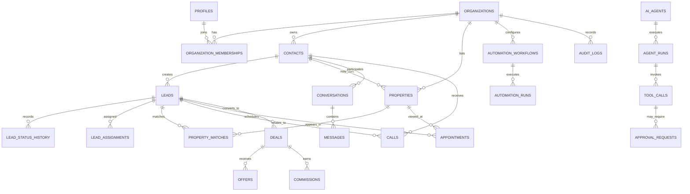

# Real Estate AI OS
# DATABASE_SCHEMA.md

**Document type:** Database architecture and schema specification  
**Status:** Proposed baseline for implementation  
**Database:** PostgreSQL on Supabase  
**Primary access pattern:** Next.js server-side services using Supabase Auth and the service/database clients  
**Schema version:** 1.0  
**Last updated:** 2026-10-24

---

## 1. Purpose

This document defines the proposed PostgreSQL data model for Real Estate AI OS, a multi-tenant operating system for real estate agencies. It is intended to guide migrations, backend implementation, row-level security (RLS), API contracts, tests, and future schema changes.

The schema covers:

- Organizations, users, memberships, roles, and permissions
- CRM contacts, leads, assignments, activities, and tasks
- Property inventory, ownership/listing relationships, amenities, media, and matching
- Conversations, messages, calls, transcripts, and communication consent
- AI agents, agent runs, tool calls, approvals, and automation workflows
- Appointments, calendars, deals, offers, commissions, and payments
- Documents, notes, integrations, webhooks, audit events, and background jobs
- Reporting support, notifications, and system configuration

This is a **starting schema**, not a claim that every feature must ship in the first release. Implement it incrementally using migrations. Validate legal, privacy, telephony, and messaging requirements for each launch market before production.

## 2. Schema design principles

1. **Tenant isolation first.** Every tenant-owned record carries `organization_id`. Tenant access is enforced with RLS and server-side authorization.
2. **UUID primary keys.** Use `gen_random_uuid()` for application entities to avoid exposing sequential identifiers.
3. **UTC timestamps.** Store instants as `timestamptz`; store the organization's IANA time-zone name separately for display and scheduling.
4. **Explicit lifecycle states.** Use constrained values for core statuses and document state transitions in application services.
5. **Normalized core, flexible metadata.** Use typed columns for query-critical fields. Use `jsonb` only for provider payloads, configurable attributes, and evolving metadata.
6. **Soft deletion only where useful.** Operational records may use `deleted_at`; legal/audit records should be append-only and not casually deleted.
7. **No secret values in ordinary tables.** Store provider secrets in Supabase Vault or a secrets manager. Database integration rows contain references and non-secret configuration only.
8. **Idempotent ingestion.** External identifiers and idempotency keys prevent duplicate leads, webhook events, messages, and job execution.
9. **Human approval for consequential actions.** Approval records are first-class, and actions must be re-authorized when executed.
10. **Minimize sensitive data.** Store only information required for the product, apply retention policies, and avoid collecting sensitive traits for lead scoring or property matching.

## 3. Naming and conventions

- Table and column names use `snake_case`.
- Primary keys are named `id`.
- Tenant key is `organization_id`.
- Creation/update timestamps are `created_at` and `updated_at`.
- Actor references use `created_by`, `updated_by`, `assigned_to`, or `user_id` as appropriate.
- Foreign keys use explicit names where helpful.
- Monetary values use `numeric(14,2)` plus an ISO 4217 currency code. Never use floating point for money.
- Area measurements use `numeric` plus an explicit unit (`sqft`, `sqm`, etc.).
- Phone numbers should be normalized to E.164 when possible, but retain a display value when useful.
- Email addresses should be normalized to lowercase for matching. Preserve the original user-entered display value only if needed.
- Do not store full payment-card data, authentication tokens, or raw credentials in this schema.

## 4. Supabase extensions and shared utility objects

Use a migration to enable the required extensions. Supabase projects may already enable some extensions.

```sql
create extension if not exists pgcrypto;
create extension if not exists citext;
create extension if not exists pg_trgm;
create extension if not exists vector;
```

`citext` is optional; application-level normalized email values are still recommended. `vector` is optional until semantic search is enabled. Do not make the product dependent on vector search for basic CRM or property search.

### 4.1 Shared updated-at trigger

```sql
create or replace function public.set_updated_at()
returns trigger
language plpgsql
as $$
begin
  new.updated_at = now();
  return new;
end;
$$;
```

Attach this trigger to mutable tables that have an `updated_at` column. Do not attach it to append-only audit or event tables.

### 4.2 Organization context helpers

RLS policies should use membership rows, not trust a client-provided `organization_id` alone.

```sql
create or replace function public.is_org_member(target_org uuid)
returns boolean
language sql
stable
security definer
set search_path = public
as $$
  select exists (
    select 1
    from public.organization_memberships m
    where m.organization_id = target_org
      and m.user_id = auth.uid()
      and m.status = 'active'
  );
$$;

create or replace function public.has_org_role(target_org uuid, allowed_roles text[])
returns boolean
language sql
stable
security definer
set search_path = public
as $$
  select exists (
    select 1
    from public.organization_memberships m
    where m.organization_id = target_org
      and m.user_id = auth.uid()
      and m.status = 'active'
      and m.role = any(allowed_roles)
  );
$$;
```

Review `SECURITY DEFINER` functions carefully. Keep their `search_path` fixed, grant execute only where necessary, and test them against privilege-escalation cases. These helpers are a baseline, not a substitute for reviewing every policy.

---

# 5. Core tenancy and identity

## 5.1 `profiles`

One application profile per Supabase Auth user.

| Column | Type | Rules / purpose |
|---|---|---|
| `id` | `uuid` | PK; references `auth.users(id)` |
| `full_name` | `text` | Display name |
| `avatar_url` | `text` | Optional profile image URL |
| `phone_e164` | `text` | Optional normalized phone |
| `locale` | `text` | Default `en-IN` |
| `created_at` | `timestamptz` | Not null |
| `updated_at` | `timestamptz` | Not null |

## 5.2 `organizations`

A tenant is typically one agency or brokerage.

| Column | Type | Rules / purpose |
|---|---|---|
| `id` | `uuid` | PK |
| `name` | `text` | Required |
| `slug` | `text` | Required, globally unique |
| `legal_name` | `text` | Optional |
| `default_currency` | `char(3)` | Default `INR`; ISO 4217 |
| `timezone` | `text` | IANA time-zone, e.g. `Asia/Kolkata` |
| `country_code` | `char(2)` | ISO 3166-1 alpha-2 |
| `business_email` | `text` | Optional |
| `business_phone` | `text` | Optional |
| `settings` | `jsonb` | Non-secret tenant settings |
| `subscription_status` | `text` | Billing lifecycle |
| `created_by` | `uuid` | FK to `profiles.id`, nullable for system setup |
| `created_at` | `timestamptz` | Not null |
| `updated_at` | `timestamptz` | Not null |
| `deleted_at` | `timestamptz` | Optional soft delete |

Recommended checks: `default_currency ~ '^[A-Z]{3}$'`, `country_code ~ '^[A-Z]{2}$'`, and `subscription_status` constrained to known values.

## 5.3 `organization_memberships`

Connects users to organizations and defines their tenant-level role.

| Column | Type | Rules / purpose |
|---|---|---|
| `id` | `uuid` | PK |
| `organization_id` | `uuid` | FK `organizations.id`, not null |
| `user_id` | `uuid` | FK `profiles.id`, not null |
| `role` | `text` | `owner`, `admin`, `manager`, `agent`, `operations`, `finance`, `viewer` |
| `status` | `text` | `invited`, `active`, `suspended`, `removed` |
| `invited_by` | `uuid` | FK `profiles.id`, nullable |
| `invited_at` | `timestamptz` | Optional |
| `joined_at` | `timestamptz` | Optional |
| `created_at` | `timestamptz` | Not null |
| `updated_at` | `timestamptz` | Not null |

Constraints: unique `(organization_id, user_id)`; index `(user_id, status)` and `(organization_id, status, role)`.

## 5.4 `teams` and `team_memberships`

`teams` groups staff by office, branch, or function.

- `teams`: `id`, `organization_id`, `name`, `description`, `manager_user_id`, `created_at`, `updated_at`, `deleted_at`.
- `team_memberships`: `id`, `organization_id`, `team_id`, `user_id`, `team_role`, `created_at`; unique `(team_id, user_id)`.

A team is not a security boundary by itself. Enforce team-scoped access in server-side authorization and, where required, explicit RLS policies.

## 5.5 `invitations`

- `id uuid primary key`
- `organization_id uuid not null`
- `email_normalized text not null`
- `role text not null`
- `token_hash text not null` (never store raw invitation tokens)
- `invited_by uuid`
- `expires_at timestamptz not null`
- `accepted_at timestamptz`
- `revoked_at timestamptz`
- `created_at timestamptz not null default now()`

Unique active invitations should be enforced by application logic or a partial unique index.

---

# 6. CRM and lead management

## 6.1 `contacts`

Represents a person or company in the agency CRM. A contact may be a buyer, seller, landlord, tenant, referrer, vendor, or other party.

Core fields:

- `id uuid primary key`
- `organization_id uuid not null`
- `contact_type text not null` (`person`, `company`)
- `first_name text`, `last_name text`, `company_name text`
- `display_name text not null`
- `email text`, `email_normalized text`
- `phone text`, `phone_e164 text`
- `alternate_phone text`
- `preferred_language text`
- `preferred_contact_channel text` (`phone`, `email`, `sms`, `whatsapp`, `none`)
- `lifecycle_status text not null` (`new`, `active`, `nurture`, `client`, `inactive`, `do_not_contact`)
- `source text`, `source_detail text`
- `assigned_to uuid`, `team_id uuid`
- `created_by uuid`, `updated_by uuid`
- `custom_fields jsonb not null default '{}'`
- `last_contacted_at timestamptz`
- `next_follow_up_at timestamptz`
- `deleted_at timestamptz`
- `created_at timestamptz not null default now()`
- `updated_at timestamptz not null default now()`

Useful indexes:
- `(organization_id, lifecycle_status, created_at desc)`
- `(organization_id, assigned_to, lifecycle_status)`
- `(organization_id, email_normalized)` where not null
- `(organization_id, phone_e164)` where not null
- GIN/trigram index on `display_name` for fuzzy search if needed.

Do not assume email or phone uniquely identifies a contact: family members may share a phone, and data may be incomplete. Deduplication should be a controlled merge workflow.

## 6.2 `contact_tags` and `tags`

- `tags`: `id`, `organization_id`, `name`, `color`, `created_at`; unique `(organization_id, lower(name))`.
- `contact_tags`: `organization_id`, `contact_id`, `tag_id`, `created_at`; composite unique `(contact_id, tag_id)`.

## 6.3 `leads`

A lead is an opportunity or enquiry, distinct from the long-lived person/contact record. One contact may have multiple leads over time.

Fields:
- `id uuid primary key`
- `organization_id uuid not null`
- `contact_id uuid` (nullable until resolved)
- `title text not null`
- `status text not null` (`new`, `attempting_contact`, `contacted`, `qualified`, `viewing_scheduled`, `negotiation`, `won`, `lost`, `disqualified`)
- `priority text not null default 'normal'` (`low`, `normal`, `high`, `urgent`)
- `source text not null`
- `source_campaign text`
- `source_external_id text`
- `assigned_to uuid`
- `team_id uuid`
- `lead_score numeric(5,2)` (optional, explainable score only)
- `qualification_status text` (`not_started`, `in_progress`, `qualified`, `unqualified`, `needs_human_review`)
- `budget_min numeric(14,2)`, `budget_max numeric(14,2)`, `budget_currency char(3)`
- `desired_transaction text` (`buy`, `rent`, `sell`, `let`, `invest`, `unknown`)
- `desired_property_types text[]`
- `desired_locations jsonb`
- `bedrooms_min smallint`, `bedrooms_max smallint`
- `requirements jsonb not null default '{}'`
- `next_action text`
- `next_follow_up_at timestamptz`
- `first_response_at timestamptz`
- `qualified_at timestamptz`
- `closed_at timestamptz`
- `lost_reason text`
- `created_by uuid`, `updated_by uuid`
- `metadata jsonb not null default '{}'`
- `deleted_at timestamptz`
- `created_at timestamptz not null default now()`
- `updated_at timestamptz not null default now()`

Checks: non-negative budget; `budget_min <= budget_max` when both supplied; bedrooms non-negative and min not greater than max.

Recommended indexes:
- `(organization_id, status, created_at desc)`
- `(organization_id, assigned_to, status)`
- `(organization_id, next_follow_up_at)` where not null and not closed
- unique `(organization_id, source, source_external_id)` where external ID is not null, if source semantics permit it.

## 6.4 `lead_assignments`

Append-only assignment history:
- `id`, `organization_id`, `lead_id`, `from_user_id`, `to_user_id`, `assigned_by`, `reason`, `created_at`.

Do not rely only on current `leads.assigned_to` if reports need assignment history.

## 6.5 `lead_status_history`

- `id`, `organization_id`, `lead_id`, `from_status`, `to_status`, `changed_by`, `reason`, `metadata jsonb`, `created_at`.

Write history from a server-side transaction when status changes.

## 6.6 `activities`

Unified CRM timeline for human and system activity.

Fields: `id`, `organization_id`, `contact_id`, `lead_id`, `deal_id`, `activity_type`, `title`, `description`, `occurred_at`, `created_by`, `source` (`user`, `ai`, `system`, `integration`), `metadata jsonb`, `created_at`.

Examples: call, email, message, note, status change, property sent, viewing completed, meeting, task completed. Do not duplicate entire message bodies here; link to the canonical message/call record.

## 6.7 `notes`

- `id`, `organization_id`, `contact_id`, `lead_id`, `property_id`, `deal_id`, `body`, `visibility` (`organization`, `team`, `private`), `created_by`, `created_at`, `updated_at`, `deleted_at`.

Private note visibility must be enforced in the query and RLS layer, not merely hidden in the UI.

## 6.8 `tasks`

- `id`, `organization_id`, `title`, `description`, `status` (`open`, `in_progress`, `completed`, `cancelled`), `priority`, `due_at`, `completed_at`, `assigned_to`, `team_id`, `created_by`, `related_contact_id`, `related_lead_id`, `related_property_id`, `related_deal_id`, `source` (`manual`, `automation`, `ai`, `integration`), `metadata jsonb`, `created_at`, `updated_at`, `deleted_at`.

Indexes: `(organization_id, assigned_to, status, due_at)`, `(organization_id, due_at)` for operational dashboards.

---

# 7. Property inventory

## 7.1 `properties`

One record per property asset/listing known to the organization. If multiple agencies can collaborate on the same asset in a future release, use a global asset table plus tenant-specific listing records rather than sharing a tenant-owned row.

Fields:
- `id uuid primary key`
- `organization_id uuid not null`
- `reference_code text not null`
- `title text not null`
- `description text`
- `property_type text not null` (`apartment`, `house`, `villa`, `townhouse`, `land`, `commercial`, `industrial`, `office`, `retail`, `other`)
- `listing_type text not null` (`sale`, `rent`, `lease`, `short_stay`, `other`)
- `status text not null` (`draft`, `active`, `under_offer`, `reserved`, `let`, `sold`, `withdrawn`, `archived`)
- `availability_status text` (`available`, `unavailable`, `unknown`)
- `price numeric(14,2)`, `currency char(3) not null`
- `rent_period text` (`weekly`, `monthly`, `yearly`, null)
- `bedrooms smallint`, `bathrooms numeric(4,1)`, `parking_spaces smallint`
- `area_value numeric(12,2)`, `area_unit text` (`sqft`, `sqm`, `acre`, `hectare`, etc.)
- `address_line_1 text`, `address_line_2 text`, `locality text`, `city text`, `region text`, `postal_code text`, `country_code char(2)`
- `latitude numeric(9,6)`, `longitude numeric(9,6)`
- `location_point geography(point, 4326)` (optional PostGIS deployment)
- `owner_contact_id uuid`
- `listing_agent_id uuid`
- `team_id uuid`
- `listed_at timestamptz`, `available_from date`, `expires_at timestamptz`
- `external_listing_id text`, `external_source text`
- `features text[] not null default '{}'`
- `amenities jsonb not null default '{}'`
- `custom_fields jsonb not null default '{}'`
- `created_by uuid`, `updated_by uuid`
- `deleted_at timestamptz`
- `created_at timestamptz not null default now()`
- `updated_at timestamptz not null default now()`

Constraints/indexes:
- unique `(organization_id, reference_code)`
- check `price >= 0` when price supplied
- check latitude in `[-90, 90]` and longitude in `[-180, 180]`
- `(organization_id, status, listing_type, price)`
- `(organization_id, city, property_type, status)`
- GIN index on `features` when feature filtering is common
- optional partial unique `(organization_id, external_source, external_listing_id)` where both values are not null.

Use PostGIS only after enabling the approved extension in the Supabase project. If PostGIS is not enabled, omit `location_point` and use latitude/longitude initially.

## 7.2 `property_media`

- `id`, `organization_id`, `property_id`, `storage_path`, `media_type` (`image`, `video`, `floorplan`, `document`, `other`), `caption`, `alt_text`, `sort_order`, `is_primary`, `uploaded_by`, `created_at`, `deleted_at`.

Store Supabase Storage paths, not public permanent URLs, for private media. Use signed URLs where access should be limited.

## 7.3 `property_amenities`

Use this normalized table if analytics/filtering across standard amenities is required:
- `id`, `organization_id`, `property_id`, `amenity_key`, `amenity_value jsonb`, `created_at`.
- Unique `(property_id, amenity_key)`.

Avoid maintaining both this table and `properties.amenities` as independent sources of truth. Pick one representation for each feature.

## 7.4 `property_price_history`

- `id`, `organization_id`, `property_id`, `old_price`, `new_price`, `currency`, `changed_by`, `reason`, `effective_at`, `created_at`.

## 7.5 `property_matches`

Stores explainable matching results, not a permanent truth about suitability.
- `id`, `organization_id`, `lead_id`, `property_id`, `match_score numeric(5,2)`, `score_version`, `match_reasons jsonb`, `mismatch_reasons jsonb`, `generated_by` (`rules`, `ai`, `hybrid`), `reviewed_by`, `review_status` (`pending`, `accepted`, `rejected`, `sent_to_contact`), `created_at`, `expires_at`.
- Unique `(lead_id, property_id, score_version)` if only one score per version is retained.

Only match on property preferences and objective requirements. Do not infer or use protected traits or sensitive personal characteristics.

---

# 8. Communications and consent

## 8.1 `communication_consents`

Track permission and opt-out state per contact, channel, and purpose.

- `id`, `organization_id`, `contact_id`
- `channel` (`phone`, `sms`, `email`, `whatsapp`, `other`)
- `purpose` (`service`, `marketing`, `ai_call`, `appointment_reminder`, `other`)
- `status` (`unknown`, `granted`, `denied`, `revoked`)
- `captured_via`, `evidence_reference`, `consent_text_version`
- `granted_at`, `revoked_at`, `expires_at`
- `captured_by`, `metadata jsonb`, `created_at`, `updated_at`

Keep consent evidence and opt-out history. Before any outbound contact, the server must evaluate current consent, channel-specific rules, local laws, quiet hours, suppression lists, and provider policy. An `unknown` state is not permission.

## 8.2 `suppression_entries`

- `id`, `organization_id`, `channel`, `address_normalized`, `reason`, `source`, `created_at`, `expires_at`.
- Unique `(organization_id, channel, address_normalized)` for active entries where appropriate.

A contact's opt-out must suppress sends even if the contact record is duplicated. Consider organization-level suppression lookup by normalized address.

## 8.3 `conversations`

A unified inbox thread, typically scoped to one contact and channel.

- `id`, `organization_id`, `contact_id`, `lead_id`
- `channel` (`email`, `sms`, `whatsapp`, `voice`, `webchat`, `portal`, `other`)
- `status` (`open`, `pending`, `resolved`, `archived`)
- `assigned_to`, `team_id`
- `external_thread_id`, `provider`
- `subject`, `last_message_at`, `last_message_preview`
- `unread_count integer not null default 0`
- `ai_mode` (`off`, `suggest`, `auto_with_approval`, `auto_allowed`)
- `metadata jsonb`, `created_at`, `updated_at`, `deleted_at`

Indexes: `(organization_id, status, last_message_at desc)`, `(organization_id, assigned_to, status)`, unique provider thread identifier where reliable.

## 8.4 `messages`

- `id`, `organization_id`, `conversation_id`, `contact_id`, `lead_id`
- `direction` (`inbound`, `outbound`, `internal`)
- `channel`, `message_type` (`text`, `template`, `media`, `system`, `other`)
- `body_text text`, `body_storage_path text`, `media_metadata jsonb`
- `sender_type` (`contact`, `user`, `ai_agent`, `system`, `integration`)
- `sender_user_id`, `ai_agent_id`
- `provider`, `provider_message_id`
- `delivery_status` (`queued`, `sent`, `delivered`, `read`, `failed`, `undelivered`, `received`)
- `idempotency_key text`
- `sent_at`, `delivered_at`, `read_at`, `failed_at`
- `failure_code`, `failure_detail`
- `reply_to_message_id`, `metadata jsonb`
- `created_at`

Use a partial unique index on `(organization_id, provider, provider_message_id)` where provider message ID is not null. Provider callbacks must be idempotent. Message body access may need stricter policies than basic CRM data.

## 8.5 `message_templates`

- `id`, `organization_id`, `name`, `channel`, `provider_template_id`, `language`, `purpose`, `body_template`, `variables jsonb`, `approval_status`, `created_by`, `created_at`, `updated_at`, `deleted_at`.

Approved template status is not a substitute for provider-side template approval.

## 8.6 `calls`

One record per attempted or completed call.

- `id`, `organization_id`, `contact_id`, `lead_id`, `conversation_id`
- `direction` (`inbound`, `outbound`)
- `provider`, `provider_call_id`, `from_number`, `to_number`
- `status` (`queued`, `ringing`, `in_progress`, `completed`, `busy`, `no_answer`, `failed`, `cancelled`)
- `initiated_by` (`user`, `ai_agent`, `automation`, `integration`)
- `initiated_by_user_id`, `ai_agent_id`
- `started_at`, `answered_at`, `ended_at`
- `duration_seconds integer`
- `recording_storage_path`, `recording_consent_status`
- `summary text`, `outcome text`, `sentiment_label text` (optional, use cautiously)
- `provider_metadata jsonb`
- `created_at`, `updated_at`

Do not expose recordings or transcripts by default to all members. Apply role checks and retention rules.

## 8.7 `call_transcripts`

- `id`, `organization_id`, `call_id`, `transcript_text`, `transcript_storage_path`, `language`, `redaction_status`, `created_at`, `deleted_at`.

If transcripts are large, store the object in private Storage and keep metadata plus a protected reference in PostgreSQL.

## 8.8 `call_transcript_segments`

Optional searchable transcript segments:
- `id`, `organization_id`, `call_id`, `sequence_number`, `speaker_label`, `start_ms`, `end_ms`, `text`, `created_at`.
- Unique `(call_id, sequence_number)`.

## 8.9 `communication_events`

Append-only normalized provider status/event log:
- `id`, `organization_id`, `channel`, `provider`, `provider_event_id`, `event_type`, `related_message_id`, `related_call_id`, `payload jsonb`, `received_at`, `processed_at`, `processing_status`, `error_detail`.
- Unique `(provider, provider_event_id)` where provider event IDs are stable.

Minimize provider payload retention. Redact credentials and sensitive data before storing raw payloads.

---

# 9. Appointments and calendar

## 9.1 `appointments`

- `id`, `organization_id`, `title`, `appointment_type` (`property_viewing`, `consultation`, `valuation`, `follow_up`, `internal`, `other`)
- `status` (`proposed`, `scheduled`, `confirmed`, `completed`, `cancelled`, `no_show`, `rescheduled`)
- `contact_id`, `lead_id`, `property_id`, `deal_id`
- `assigned_to`, `team_id`
- `starts_at timestamptz not null`, `ends_at timestamptz not null`
- `timezone text not null`
- `location_type` (`property`, `office`, `video`, `phone`, `other`)
- `location_text`, `meeting_url`
- `external_calendar_provider`, `external_event_id`
- `created_by`, `source` (`user`, `ai`, `automation`, `integration`)
- `cancellation_reason`, `notes`
- `metadata jsonb`, `created_at`, `updated_at`, `deleted_at`

Check `ends_at > starts_at`. Use a transaction and appropriate locking or exclusion constraints to prevent double-booking for staff resources. External calendar availability is not guaranteed by a local row alone; synchronize provider state and handle conflicts.

## 9.2 `calendar_connections`

- `id`, `organization_id`, `user_id`, `provider` (`google`, `microsoft`, `other`)
- `provider_account_id`, `calendar_id`, `status`, `scopes text[]`
- `secret_reference text` (Vault/secrets manager reference only)
- `last_synced_at`, `last_sync_error`, `created_at`, `updated_at`.

Do not store OAuth refresh tokens in plaintext columns.

## 9.3 `calendar_sync_events`

- `id`, `organization_id`, `calendar_connection_id`, `provider_event_id`, `local_appointment_id`, `event_type`, `payload jsonb`, `sync_status`, `last_error`, `created_at`, `updated_at`.
- Unique `(calendar_connection_id, provider_event_id)`.

---

# 10. Deals, offers, and commissions

## 10.1 `deals`

- `id`, `organization_id`, `lead_id`, `primary_contact_id`, `property_id`
- `title`, `transaction_type` (`sale`, `purchase`, `rental`, `lease`, `other`)
- `stage` (`qualification`, `viewing`, `offer`, `negotiation`, `under_contract`, `completed`, `lost`, `cancelled`)
- `status` (`open`, `won`, `lost`, `cancelled`)
- `expected_value numeric(14,2)`, `final_value numeric(14,2)`, `currency char(3)`
- `expected_close_date date`, `closed_at timestamptz`
- `owner_user_id`, `team_id`
- `lost_reason`, `created_by`, `updated_by`
- `metadata jsonb`, `created_at`, `updated_at`, `deleted_at`.

## 10.2 `deal_participants`

- `id`, `organization_id`, `deal_id`, `contact_id`, `participant_role` (`buyer`, `seller`, `landlord`, `tenant`, `referrer`, `other`), `created_at`.
- Unique `(deal_id, contact_id, participant_role)`.

## 10.3 `offers`

- `id`, `organization_id`, `deal_id`, `property_id`, `submitted_by_contact_id`
- `offer_amount numeric(14,2)`, `currency char(3)`, `status` (`draft`, `submitted`, `countered`, `accepted`, `rejected`, `withdrawn`, `expired`)
- `submitted_at`, `expires_at`, `terms jsonb`, `notes`, `created_by`, `created_at`, `updated_at`.

## 10.4 `commission_rules`

- `id`, `organization_id`, `name`, `transaction_type`, `calculation_type` (`percentage`, `fixed`, `tiered`), `configuration jsonb`, `effective_from`, `effective_to`, `active`, `created_at`, `updated_at`.

Commission configuration must be versioned and validated. Do not silently recompute historical commissions using newly edited rules.

## 10.5 `commissions`

- `id`, `organization_id`, `deal_id`, `beneficiary_user_id`, `rule_id`
- `gross_commission numeric(14,2)`, `adjustments numeric(14,2) default 0`, `net_commission numeric(14,2)`, `currency char(3)`
- `status` (`estimated`, `approved`, `payable`, `paid`, `void`)
- `calculation_snapshot jsonb`, `approved_by`, `approved_at`, `paid_at`, `created_at`, `updated_at`.

Store a calculation snapshot and require appropriate approval before marking a commission payable or paid.

## 10.6 `payments`

Operational payment tracking only, not a payment-card vault.
- `id`, `organization_id`, `deal_id`, `commission_id`, `payer_contact_id`
- `amount numeric(14,2)`, `currency char(3)`, `status` (`pending`, `processing`, `succeeded`, `failed`, `refunded`, `cancelled`)
- `payment_provider`, `provider_payment_id`, `due_at`, `paid_at`, `metadata jsonb`, `created_at`, `updated_at`.
- Unique `(payment_provider, provider_payment_id)` where provider payment ID is not null.

---

# 11. AI agents, tool execution, and approvals

## 11.1 `ai_agents`

Tenant-configured agent definitions.

- `id`, `organization_id`, `name`, `agent_type` (`lead_qualification`, `appointment_setter`, `follow_up`, `property_matcher`, `support`, `custom`)
- `description`, `status` (`draft`, `active`, `paused`, `archived`)
- `model_provider`, `model_name`
- `system_prompt_version_id`
- `configuration jsonb` (non-secret settings)
- `allowed_tools text[]`
- `autonomy_mode` (`suggest_only`, `approval_required`, `bounded_auto`)
- `max_steps integer`, `max_runtime_seconds integer`, `daily_budget numeric(14,4)`
- `created_by`, `created_at`, `updated_at`, `deleted_at`.

The application must enforce allowed tools independently of prompt instructions. Do not rely on the model to self-police permissions.

## 11.2 `ai_prompt_versions`

- `id`, `organization_id`, `agent_id`, `version integer`, `system_prompt text`, `change_summary`, `created_by`, `created_at`, `is_active`.
- Unique `(agent_id, version)`.

Prompts may contain sensitive business logic. Restrict read/write access and never place provider secrets inside prompts.

## 11.3 `agent_runs`

One record per agent invocation.

- `id`, `organization_id`, `agent_id`, `trigger_type` (`manual`, `event`, `schedule`, `webhook`, `message`, `call`)
- `trigger_reference`, `status` (`queued`, `running`, `waiting_approval`, `succeeded`, `failed`, `cancelled`, `timed_out`)
- `related_contact_id`, `related_lead_id`, `related_conversation_id`, `related_call_id`, `related_appointment_id`
- `input_summary jsonb`, `output_summary jsonb`
- `model_provider`, `model_name`, `prompt_version_id`
- `started_at`, `completed_at`, `duration_ms`
- `input_tokens integer`, `output_tokens integer`, `estimated_cost numeric(14,6)`
- `error_code`, `error_message`, `trace_id`
- `created_at`, `updated_at`.

Avoid storing unrestricted chain-of-thought. Store concise operational summaries, structured outputs, tool inputs/outputs needed for audit, and policy decisions.

## 11.4 `agent_run_steps`

- `id`, `organization_id`, `agent_run_id`, `step_number`, `step_type` (`model`, `tool`, `policy_check`, `handoff`, `finalize`)
- `status`, `name`, `input_summary jsonb`, `output_summary jsonb`, `started_at`, `completed_at`, `error_code`, `created_at`.
- Unique `(agent_run_id, step_number)`.

## 11.5 `tool_calls`

- `id`, `organization_id`, `agent_run_id`, `tool_name`, `tool_version`
- `status` (`proposed`, `awaiting_approval`, `approved`, `executing`, `succeeded`, `failed`, `rejected`, `cancelled`)
- `arguments jsonb`, `result_summary jsonb`
- `idempotency_key`, `requested_at`, `approved_by`, `approved_at`, `executed_at`
- `error_code`, `error_message`, `created_at`, `updated_at`.

Never allow arbitrary SQL, shell commands, unrestricted URLs, or arbitrary code execution as a normal agent tool. Tool handlers must validate input schemas, tenant scope, authorization, idempotency, and side-effect policy.

## 11.6 `approval_requests`

- `id`, `organization_id`, `requested_by_type` (`user`, `ai_agent`, `automation`, `system`)
- `requested_by_user_id`, `agent_run_id`, `tool_call_id`
- `action_type`, `action_summary`, `risk_level` (`low`, `medium`, `high`, `critical`)
- `payload jsonb`, `status` (`pending`, `approved`, `rejected`, `expired`, `cancelled`)
- `requested_at`, `expires_at`, `decided_by`, `decided_at`, `decision_note`
- `executed_at`, `execution_result jsonb`, `created_at`, `updated_at`.

The action service must re-check current authorization, consent, target state, and approval validity at execution time. Approval does not override a later opt-out or revoked permission.

---

# 12. Automation and background processing

## 12.1 `automation_workflows`

- `id`, `organization_id`, `name`, `description`, `trigger_type`, `trigger_config jsonb`
- `status` (`draft`, `active`, `paused`, `archived`)
- `version integer`, `definition jsonb`, `created_by`, `created_at`, `updated_at`, `deleted_at`.

Workflow definitions should be versioned. Validate JSON against a versioned schema before activation.

## 12.2 `automation_runs`

- `id`, `organization_id`, `workflow_id`, `workflow_version`, `trigger_event_id`
- `status` (`queued`, `running`, `waiting`, `succeeded`, `failed`, `cancelled`)
- `input_summary jsonb`, `output_summary jsonb`, `started_at`, `completed_at`
- `error_code`, `error_message`, `trace_id`, `created_at`, `updated_at`.

## 12.3 `automation_run_steps`

- `id`, `organization_id`, `automation_run_id`, `step_key`, `step_type`, `status`
- `input_summary jsonb`, `output_summary jsonb`, `attempt_count`, `started_at`, `completed_at`, `error_code`, `error_message`, `created_at`.
- Unique `(automation_run_id, step_key)`.

## 12.4 `domain_events`

An append-only application event log used for durable internal processing.

- `id uuid primary key`
- `organization_id uuid`
- `event_type text not null`
- `aggregate_type text not null`
- `aggregate_id uuid not null`
- `event_version integer not null default 1`
- `payload jsonb not null`
- `idempotency_key text`
- `occurred_at timestamptz not null default now()`
- `published_at timestamptz`
- `processing_status text not null default 'pending'`
- `attempt_count integer not null default 0`
- `last_error text`
- `trace_id text`

Indexes: `(processing_status, occurred_at)` and `(organization_id, aggregate_type, aggregate_id, occurred_at)`. Restrict payloads to data required by consumers; avoid copying full PII into events.

## 12.5 `webhook_events`

For provider webhooks and inbound integrations.

- `id`, `organization_id` nullable until tenant resolution, `provider`, `provider_event_id`, `event_type`, `payload jsonb`, `signature_verified boolean`, `received_at`, `processed_at`, `processing_status`, `attempt_count`, `last_error`, `trace_id`.
- Unique `(provider, provider_event_id)` where event ID is present.

Verify webhook signatures before processing. Never trust tenant identifiers from an unverified payload.

## 12.6 `job_runs`

For scheduled/background work when not managed entirely by an external queue.

- `id`, `organization_id`, `job_type`, `status`, `payload jsonb`, `idempotency_key`, `run_after`, `locked_at`, `locked_by`, `attempt_count`, `max_attempts`, `last_error`, `started_at`, `completed_at`, `created_at`, `updated_at`.
- Unique `(organization_id, job_type, idempotency_key)` when idempotency key is not null.
- Index `(status, run_after)`.

For high-volume workloads, use a dedicated queue/worker system. Do not treat a database table as a replacement for queue visibility, retry policies, or worker heartbeats without implementing them.

---

# 13. Documents and file metadata

## 13.1 `documents`

- `id`, `organization_id`, `name`, `document_type`, `status` (`uploaded`, `processing`, `ready`, `failed`, `archived`)
- `storage_bucket`, `storage_path`, `mime_type`, `file_size_bytes`
- `checksum_sha256`, `uploaded_by`, `uploaded_at`
- `related_contact_id`, `related_lead_id`, `related_property_id`, `related_deal_id`
- `classification` (`general`, `confidential`, `restricted`)
- `retention_until`, `processed_at`, `processing_error`
- `metadata jsonb`, `created_at`, `updated_at`, `deleted_at`.

Store files in private Supabase Storage buckets. The database row is metadata; it is not a substitute for Storage access policies. Validate file type and size, scan uploads where feasible, and use short-lived signed URLs.

## 13.2 `document_extractions`

- `id`, `organization_id`, `document_id`, `extractor_version`, `status`, `extracted_fields jsonb`, `confidence jsonb`, `review_status` (`unreviewed`, `approved`, `rejected`, `needs_correction`), `reviewed_by`, `reviewed_at`, `created_at`, `updated_at`.

AI-extracted facts should not silently overwrite verified property or deal data. Preserve provenance and require review for consequential changes.

## 13.3 `document_chunks`

Optional RAG/search table:
- `id`, `organization_id`, `document_id`, `chunk_index`, `content`, `token_count`, `embedding vector(1536)` (dimension must match the selected embedding model), `metadata jsonb`, `created_at`.
- Unique `(document_id, chunk_index)`.
- Add a vector index only after validating embedding model, query patterns, and tenant filtering. For strict tenant isolation, always apply organization constraints before returning chunks.

If the embedding provider uses a different dimension, alter the column accordingly. Do not mix embeddings from different models in the same vector index unless explicitly designed.

---

# 14. Integrations and external systems

## 14.1 `integrations`

- `id`, `organization_id`, `provider`, `integration_type` (`crm`, `telephony`, `messaging`, `calendar`, `email`, `portal`, `analytics`, `other`)
- `display_name`, `status` (`connected`, `disconnected`, `error`, `needs_reauth`, `paused`)
- `external_account_id`, `configuration jsonb`
- `secret_reference text` (Vault/secrets manager reference)
- `scopes text[]`, `connected_by`, `connected_at`, `last_synced_at`, `last_error`
- `created_at`, `updated_at`, `deleted_at`.

Unique constraint should reflect provider/account semantics, for example `(organization_id, provider, external_account_id)` when external account ID exists.

## 14.2 `integration_sync_runs`

- `id`, `organization_id`, `integration_id`, `sync_type`, `status`, `started_at`, `completed_at`, `records_read`, `records_created`, `records_updated`, `records_skipped`, `error_count`, `summary jsonb`, `error_detail`, `created_at`.

## 14.3 `external_id_mappings`

Maps internal records to provider records.
- `id`, `organization_id`, `integration_id`, `entity_type`, `internal_id`, `external_id`, `external_parent_id`, `last_synced_at`, `sync_status`, `metadata jsonb`, `created_at`, `updated_at`.
- Unique `(integration_id, entity_type, external_id)`.
- Unique `(integration_id, entity_type, internal_id)` when one-to-one mapping is expected.

## 14.4 `api_keys`

Only if the product exposes tenant-scoped API keys.
- `id`, `organization_id`, `name`, `key_prefix`, `key_hash`, `scopes text[]`, `created_by`, `last_used_at`, `expires_at`, `revoked_at`, `created_at`.
- Store only a cryptographic hash of the secret. Show the raw key once at creation.
- Do not use this table for user session tokens.

---

# 15. Notifications, settings, and auditability

## 15.1 `notifications`

- `id`, `organization_id`, `user_id`, `notification_type`, `title`, `body`, `entity_type`, `entity_id`, `read_at`, `delivery_channel`, `delivery_status`, `metadata jsonb`, `created_at`.

Index `(organization_id, user_id, read_at, created_at desc)`.

## 15.2 `notification_preferences`

- `id`, `organization_id`, `user_id`, `notification_type`, `channel`, `enabled`, `quiet_hours jsonb`, `created_at`, `updated_at`.
- Unique `(organization_id, user_id, notification_type, channel)`.

## 15.3 `organization_settings`

Optional normalized settings table for settings requiring validation and versioning:
- `id`, `organization_id`, `setting_key`, `setting_value jsonb`, `version`, `updated_by`, `created_at`, `updated_at`.
- Unique `(organization_id, setting_key)`.

Do not put secrets in settings JSON.

## 15.4 `audit_logs`

Append-only audit trail for security-sensitive and business-critical actions.

- `id uuid primary key`
- `organization_id uuid`
- `actor_type text not null` (`user`, `ai_agent`, `system`, `integration`)
- `actor_user_id uuid`
- `actor_agent_id uuid`
- `action text not null`
- `entity_type text`
- `entity_id uuid`
- `request_id text`
- `trace_id text`
- `ip_hash text` (avoid retaining raw IP unless justified)
- `user_agent_summary text`
- `before_snapshot jsonb`
- `after_snapshot jsonb`
- `reason text`
- `created_at timestamptz not null default now()`

Do not include passwords, access tokens, secret values, full payment details, or unnecessary message content in audit snapshots. Restrict reads to authorized administrators and security staff. Prevent ordinary clients from updating or deleting audit rows.

## 15.5 `data_export_jobs`

- `id`, `organization_id`, `requested_by`, `status`, `scope jsonb`, `storage_path`, `expires_at`, `completed_at`, `error_detail`, `created_at`, `updated_at`.

Exports should be access-controlled, audited, time-limited, and generated by a trusted server-side worker.

---

# 16. Recommended enum strategy

For a rapidly evolving SaaS, `text` columns with `CHECK` constraints can be easier to evolve than PostgreSQL enum types. Use one consistent strategy per domain. Example:

```sql
alter table public.leads
  add constraint leads_status_check
  check (status in (
    'new', 'attempting_contact', 'contacted', 'qualified',
    'viewing_scheduled', 'negotiation', 'won', 'lost', 'disqualified'
  ));
```

Add constraints in migrations after cleaning existing data. Prefer a controlled application state-transition service over allowing any valid status to transition to any other valid status.

---

# 17. Foreign-key and deletion policy

Recommended baseline:

- Tenant-owned operational rows reference `organizations(id)` with `ON DELETE RESTRICT` or soft deletion. Avoid cascading deletion of an entire tenant's business data accidentally.
- Membership rows may cascade when a user is permanently removed only if retention/legal policy allows it; otherwise deactivate membership.
- Contact, lead, property, and deal relations should normally use `ON DELETE RESTRICT` or `SET NULL` depending on whether the historical record remains meaningful.
- Messages, calls, approvals, and audit logs should not be casually cascade-deleted.
- Use `deleted_at` for recoverable user-facing entities; filter deleted rows in application queries and policies.
- A deletion request must be implemented as a controlled workflow covering database rows, Storage objects, provider copies, backups, legal retention, and audit requirements.

---

# 18. Row-level security (RLS)

## 18.1 General policy requirements

Enable RLS on all tenant-owned tables exposed through Supabase APIs. Do not rely on hiding UI controls. Use server-side service functions for privileged operations, and avoid using the Supabase service-role key in browsers.

Baseline policy intent:

- Authenticated users can select rows only when they are active members of the row's organization.
- Inserts must target an organization where the user is an active member and must satisfy role/ownership rules.
- Updates require both visibility and permission to modify that record.
- Deletes are denied by default for audit logs, events, messages, calls, and finance history.
- `organization_id` must be immutable after insert unless a deliberate, audited transfer workflow exists.
- Sensitive tables (transcripts, recordings, integration metadata, approvals, finance) need narrower policies than ordinary CRM data.
- Membership-management operations should be restricted to owners/admins and validated server-side.
- Webhook and background workers use server-side credentials and explicit tenant resolution. Never expose privileged keys to the browser.

## 18.2 Example RLS policies

These examples illustrate the pattern. They are not a complete security review and must be adapted for each table's sensitivity.

```sql
alter table public.contacts enable row level security;

create policy "contacts_select_org_members"
on public.contacts
for select
to authenticated
using (public.is_org_member(organization_id));

create policy "contacts_insert_org_members"
on public.contacts
for insert
to authenticated
with check (public.is_org_member(organization_id));

create policy "contacts_update_org_members"
on public.contacts
for update
to authenticated
using (public.is_org_member(organization_id))
with check (public.is_org_member(organization_id));
```

For role-restricted operations:

```sql
create policy "organization_admins_manage_settings"
on public.organization_settings
for all
to authenticated
using (public.has_org_role(organization_id, array['owner', 'admin']))
with check (public.has_org_role(organization_id, array['owner', 'admin']));
```

Avoid a broad `FOR ALL` policy on every table. Create explicit policies and test select/insert/update/delete independently.

## 18.3 RLS helper and recursion caution

Because membership policies may query `organization_memberships`, ensure helper functions are carefully designed to avoid policy recursion and privilege leakage. Review the exact behavior of `SECURITY DEFINER` functions in the deployed Supabase version. Add indexes on `organization_memberships(user_id, organization_id, status)` and test with at least two organizations and multiple roles.

## 18.4 Role permissions matrix

| Capability | Owner | Admin | Manager | Agent | Operations | Finance | Viewer |
|---|---:|---:|---:|---:|---:|---:|---:|
| Manage subscription/tenant | Yes | Limited | No | No | No | No | No |
| Manage members | Yes | Yes | Team-limited | No | No | No | No |
| View organization CRM | Yes | Yes | Team/organization per policy | Assigned/team per policy | Operational scope | Limited | Read-only scope |
| Edit leads/contacts | Yes | Yes | Yes | Assigned/team | Limited | No | No |
| Manage property inventory | Yes | Yes | Yes | Permission-based | Yes | Read-only as needed | Read-only |
| Run/approve AI actions | Yes | Yes | Policy-based | Policy-based | Policy-based | No | No |
| View call recordings/transcripts | Explicit permission | Explicit permission | Explicit permission | Assigned records only | Limited | No | No |
| View/edit commissions/payments | Yes | Policy-based | No | Own commission summary | No | Yes | No |
| View audit logs | Yes | Yes | Limited | No | Limited | Finance-relevant | No |

Implement fine-grained authorization in server-side service functions, with RLS as the data boundary. This table is a product default and should be configurable where necessary.

---

# 19. Core relationship map



This is a conceptual map, not the complete set of foreign keys.

---

# 20. Example baseline SQL migration

The following excerpt illustrates the level of specificity expected in migrations. Build the production schema in small, ordered migrations rather than applying one enormous file.

```sql
create table public.profiles (
  id uuid primary key references auth.users(id) on delete cascade,
  full_name text,
  avatar_url text,
  phone_e164 text,
  locale text not null default 'en-IN',
  created_at timestamptz not null default now(),
  updated_at timestamptz not null default now()
);

create table public.organizations (
  id uuid primary key default gen_random_uuid(),
  name text not null,
  slug text not null unique,
  legal_name text,
  default_currency char(3) not null default 'INR'
    check (default_currency ~ '^[A-Z]{3}$'),
  timezone text not null default 'Asia/Kolkata',
  country_code char(2) not null default 'IN'
    check (country_code ~ '^[A-Z]{2}$'),
  business_email text,
  business_phone text,
  settings jsonb not null default '{}'::jsonb,
  subscription_status text not null default 'trial'
    check (subscription_status in ('trial','active','past_due','cancelled','suspended')),
  created_by uuid references public.profiles(id) on delete set null,
  created_at timestamptz not null default now(),
  updated_at timestamptz not null default now(),
  deleted_at timestamptz
);

create table public.organization_memberships (
  id uuid primary key default gen_random_uuid(),
  organization_id uuid not null references public.organizations(id) on delete restrict,
  user_id uuid not null references public.profiles(id) on delete restrict,
  role text not null check (role in ('owner','admin','manager','agent','operations','finance','viewer')),
  status text not null default 'active'
    check (status in ('invited','active','suspended','removed')),
  invited_by uuid references public.profiles(id) on delete set null,
  invited_at timestamptz,
  joined_at timestamptz,
  created_at timestamptz not null default now(),
  updated_at timestamptz not null default now(),
  unique (organization_id, user_id)
);

create index organization_memberships_user_org_status_idx
  on public.organization_memberships(user_id, organization_id, status);

create table public.contacts (
  id uuid primary key default gen_random_uuid(),
  organization_id uuid not null references public.organizations(id) on delete restrict,
  contact_type text not null default 'person'
    check (contact_type in ('person','company')),
  first_name text,
  last_name text,
  company_name text,
  display_name text not null,
  email text,
  email_normalized text,
  phone text,
  phone_e164 text,
  preferred_language text,
  preferred_contact_channel text
    check (preferred_contact_channel in ('phone','email','sms','whatsapp','none')),
  lifecycle_status text not null default 'new'
    check (lifecycle_status in ('new','active','nurture','client','inactive','do_not_contact')),
  source text,
  source_detail text,
  assigned_to uuid references public.profiles(id) on delete set null,
  team_id uuid,
  custom_fields jsonb not null default '{}'::jsonb,
  last_contacted_at timestamptz,
  next_follow_up_at timestamptz,
  created_by uuid references public.profiles(id) on delete set null,
  updated_by uuid references public.profiles(id) on delete set null,
  deleted_at timestamptz,
  created_at timestamptz not null default now(),
  updated_at timestamptz not null default now()
);

create index contacts_org_status_created_idx
  on public.contacts(organization_id, lifecycle_status, created_at desc);
create index contacts_org_assignee_status_idx
  on public.contacts(organization_id, assigned_to, lifecycle_status);
create index contacts_org_email_idx
  on public.contacts(organization_id, email_normalized)
  where email_normalized is not null;
create index contacts_org_phone_idx
  on public.contacts(organization_id, phone_e164)
  where phone_e164 is not null;

alter table public.contacts enable row level security;
create policy "contacts_select_org_members"
  on public.contacts for select to authenticated
  using (public.is_org_member(organization_id));
create policy "contacts_insert_org_members"
  on public.contacts for insert to authenticated
  with check (public.is_org_member(organization_id));
create policy "contacts_update_org_members"
  on public.contacts for update to authenticated
  using (public.is_org_member(organization_id))
  with check (public.is_org_member(organization_id));
```

The full implementation should split table creation, indexes, functions, RLS policies, and seed data into reviewable migrations.

---

# 21. Indexing and query performance

Start with indexes tied to known screen and workflow queries. Add indexes only after checking query plans and actual usage.

| Screen / operation | Typical index |
|---|---|
| Lead pipeline | `(organization_id, status, created_at desc)` |
| My leads | `(organization_id, assigned_to, status, created_at desc)` |
| Follow-up queue | `(organization_id, next_follow_up_at)` partial for active leads |
| Contact search | normalized email/phone; trigram name index if required |
| Property inventory | `(organization_id, status, listing_type, price)` |
| City/property filter | `(organization_id, city, property_type, status)` |
| Unified inbox | `(organization_id, status, last_message_at desc)` |
| Messages in thread | `(conversation_id, created_at)` |
| Agent run monitoring | `(organization_id, status, created_at desc)` |
| Job queue | `(status, run_after)` |
| Unread notifications | `(organization_id, user_id, read_at, created_at desc)` |
| Audit investigation | `(organization_id, entity_type, entity_id, created_at desc)` |

Avoid redundant indexes that slow writes. For large event/message/audit tables, consider time-based partitioning only after measuring volume and maintenance requirements.

---

# 22. Data retention and privacy

Retention is a product and legal decision, not only a schema decision. Define a retention schedule by data category and launch market.

Recommended categories to configure:

- CRM records and transaction records
- Marketing consent and suppression evidence
- Messages and attachments
- Call recordings and transcripts
- AI input/output summaries and tool audit
- Provider webhook payloads
- Documents and extracted content
- Audit logs and data exports
- Failed jobs and observability metadata

Requirements:
- Do not retain call recordings indefinitely by default.
- Separate retention of recording media from call metadata.
- Redact secrets and unnecessary personal data from provider payloads and logs.
- Implement deletion/export requests as audited workflows.
- Keep opt-out evidence where legally required even if other profile data is deleted.
- Ensure backups, third-party processors, and provider-side copies are included in retention planning.
- Apply data minimization to AI context: send only the minimum relevant records to a model or provider.

---

# 23. Migration and implementation sequence

Implement in phases. Each phase should include migration tests, RLS tests, and rollback planning.

### Phase 1: Tenant foundation
1. Extensions and utility functions
2. `profiles`, `organizations`, `organization_memberships`, `teams`, `team_memberships`, `invitations`
3. RLS helpers and tenant isolation tests
4. Audit logging foundation

### Phase 2: CRM and inventory
1. `contacts`, tags, `leads`, assignments, status history
2. `activities`, `notes`, `tasks`
3. `properties`, media, price history, property matches
4. CRM and property indexes

### Phase 3: Communication
1. Consent and suppression
2. Conversations, messages, templates
3. Calls, transcripts, communication events
4. Provider webhook idempotency and retention jobs

### Phase 4: Operations
1. Appointments and calendar connections
2. Deals, participants, offers
3. Commission rules, commissions, payment tracking
4. Documents and extraction workflow

### Phase 5: AI and automation
1. AI agents and prompt versions
2. Agent runs, steps, tool calls, approvals
3. Automation workflows/runs/steps
4. Domain events, webhook events, job processing

### Phase 6: Integrations and analytics
1. Integrations, sync runs, external ID mappings
2. Notifications and preferences
3. Export jobs
4. Performance tuning, partitions if justified, and reporting views

---

# 24. Required automated tests

At minimum, add database/integration tests for:

1. A user in Organization A cannot select, insert, update, or delete Organization B records.
2. A suspended or removed membership loses tenant access.
3. A user cannot change `organization_id` on an existing row to move it into another tenant.
4. Agent role cannot access finance or restricted call transcripts without explicit permission.
5. A contact's opt-out blocks outbound message/call initiation, even when initiated by an AI agent or automation.
6. Provider webhooks are idempotent and invalid signatures are rejected.
7. Duplicate inbound leads are handled through the intended dedupe process.
8. Approval is required for configured high-risk actions and revalidated at execution time.
9. Agent tools cannot access records outside the current tenant or allowed record scope.
10. Concurrent appointment requests cannot silently double-book the same resource.
11. Commission calculations use the correct versioned rule and stored calculation snapshot.
12. Soft-deleted rows are not accidentally exposed in ordinary list/search APIs.
13. Deletion/export jobs honor access controls and retention policies.
14. Audit rows cannot be changed by normal authenticated clients.
15. Migration rollback or forward-fix procedure is documented for every production migration.

Use a dedicated test project or isolated database. Do not run destructive tests against production data.

---

# 25. Operational rules for backend developers

- Resolve the active organization from the authenticated user's authorized memberships; never trust a browser-supplied organization ID as authorization.
- Every server-side query for tenant data must be tenant-scoped, even when RLS also exists.
- Validate request payloads with a schema library before writing to PostgreSQL.
- Use transactions for multi-row domain operations such as lead creation plus assignment history and status history.
- Use an outbox/domain event for durable side effects that must happen after a database commit.
- Use idempotency keys for retries and provider callbacks.
- Keep external provider calls outside long-running database transactions.
- Use server-side functions for cross-table permission checks and consequential mutations.
- Use explicit projections for AI context; do not dump entire database rows into prompts.
- Do not expose internal error traces, provider payloads, or secrets to clients.
- Version prompts, workflows, commission rules, and extraction schemas.
- Log actor, organization, action, and correlation IDs for sensitive mutations.
- Use a controlled migration tool and review migrations in version control. Never manually change production schema without a recorded migration.

---

# 26. Open decisions before production

Resolve and record these as architecture decision records:

1. Which launch countries and real estate compliance regimes are in scope?
2. Will the first release support one currency per organization or multi-currency reporting?
3. Will the first release support branch/team-level data visibility, or only organization-level access?
4. Which telephony, WhatsApp, email, and calendar providers will be supported first?
5. What is the required retention period for recordings, transcripts, messages, and AI execution logs?
6. Will property inventory be manually managed, imported from portals, or synchronized from existing CRMs?
7. Which embedding model and vector dimension will be used, if semantic search ships?
8. What is the expected scale of messages, calls, leads, properties, and event volume?
9. Which operations require human approval by default?
10. Which billing/subscription provider and metering model will be used?
11. What is the policy for merging duplicate contacts and preserving provenance?
12. Are any customers subject to data residency or contractual deletion requirements?

---

# 27. Definition of done

The database foundation is ready for a production pilot when:

- All in-scope tables are represented by versioned migrations.
- Foreign keys, checks, unique constraints, and indexes are reviewed.
- RLS is enabled and tested for every table exposed to client access.
- Tenant isolation is proven with cross-organization negative tests.
- Role permissions and sensitive data boundaries are enforced server-side.
- Consent, suppression, approval, idempotency, audit, and retention paths are implemented.
- Provider secrets are stored outside ordinary application tables.
- Backup/restore and migration recovery procedures have been tested.
- Query plans for the main CRM, property, inbox, and dashboard screens are acceptable.
- Schema documentation and architecture decision records are kept in version control.

**Implementation recommendation:** begin with tenancy, CRM, property inventory, and RLS. Add communications and AI execution only after isolation and audit tests pass. Treat AI actions, outbound communications, finance, and document access as privileged workflows, not ordinary CRUD.
