# BlazeReach AI — Real Estate AI OS
## System Connection, AI Agent Architecture, and End-to-End Workflow

**Version:** 1.0  
**Purpose:** Define how users, the frontend, backend, database, orchestrator, eight AI agents, and external providers work together.  
**Implementation:** Claude Code, custom application code, backend services, background workers, and scheduled jobs. **No n8n, Make, Zapier, or other no-code workflow platforms.**  
**Voice:** Retell AI. **Reasoning:** Claude API where useful. **Data:** Existing backend and PostgreSQL/Supabase, subject to repository audit.

> Treat this as an implementation blueprint. Claude Code must inspect the existing repository and documentation, reuse existing components, and adapt names/routes/tables to the real codebase before implementing anything.

---

# 1. Core design principles

1. The backend is the authority for data access, permissions, and business actions.
2. PostgreSQL is the source of truth for CRM records, properties, appointments, workflow state, and business outcomes.
3. The frontend never receives privileged provider or model credentials.
4. Agents use narrowly scoped, typed backend tools. No unrestricted SQL, shell, or arbitrary network tools.
5. Use deterministic code for validation, authorization, filtering, booking constraints, and exact calculations.
6. Use Claude for language tasks such as extraction, classification, summarization, and grounded explanations.
7. Retell handles voice infrastructure; the backend remains responsible for business logic and persistence.
8. Background work must not depend on a browser tab staying open.
9. Every tenant-owned record and referenced entity must be checked against the same authorized organization.
10. Retries must be safe: duplicate events must not create duplicate appointments or messages.
11. Consent, opt-outs, channel rules, quiet hours, rate limits, and applicable legal requirements must be checked before external communications.
12. High-impact or restricted actions must pause for an authorized human when policy requires it.

# 2. High-level system architecture

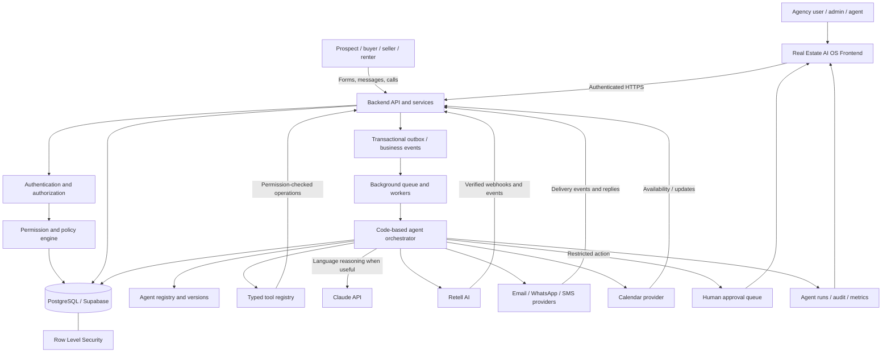

### Component responsibilities

- **Frontend:** Dashboard, CRM, configuration, agent status, approvals, and reports.
- **Backend API:** Authentication-aware business operations, validation, authorization, and persistence.
- **Database/RLS:** Durable business records and tenant isolation.
- **Outbox/events:** Reliably publish business events after successful changes.
- **Workers/scheduler:** Execute asynchronous and time-based tasks.
- **Orchestrator:** Runs explicit workflow state machines and invokes the right agent.
- **Agent runtime:** Calls Claude when reasoning is needed and validates the result.
- **Tool registry:** Exposes only permitted backend operations.
- **Retell:** Voice conversations and voice-provider events.
- **External providers:** Approved communication, calendar, and other integrations.
- **Observability:** Run history, errors, approvals, costs, and outcomes.

# 3. User → frontend → backend request flow

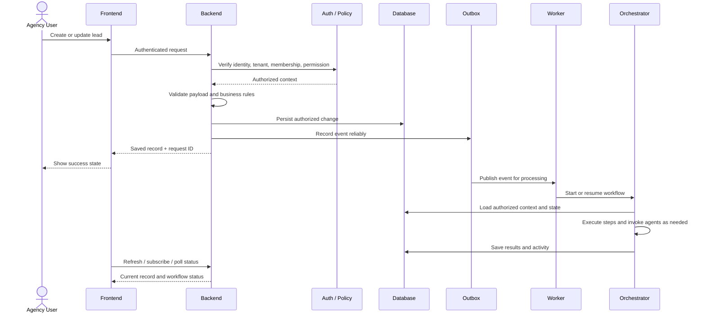

For each protected request, the backend must verify identity, organization membership, permission, request schema, and ownership of referenced records. The frontend may hide unavailable controls, but backend authorization is mandatory.

# 4. The eight specialized AI agents

These are eight roles sharing one runtime, database, tool registry, security layer, and event system. They are not eight separate applications or databases.

## Agent 1 — AI Lead Intake Agent

**Mission:** Capture, normalize, deduplicate, and route incoming leads.

**Inputs:** Website forms, property portals, CRM imports, manual entries, inbound-call events, and authorized integration events.

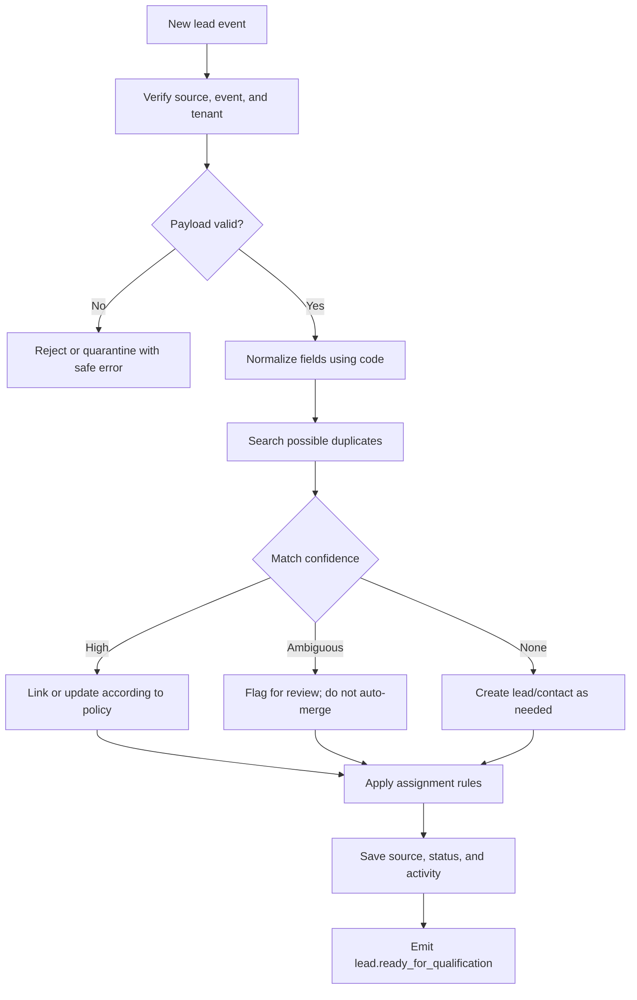

**Responsibilities**
- Validate required fields and normalize contact data.
- Preserve source and attribution.
- Detect likely duplicates.
- Link records only when the match is sufficiently reliable.
- Apply deterministic lead-assignment rules.
- Record the activity timeline and trigger qualification.

**Possible tools:** `validate_lead_payload`, `search_possible_duplicates`, `create_lead`, `update_lead`, `link_lead_to_contact`, `assign_lead`, `create_activity`, `emit_business_event`.

**Autonomy:** High for validation, normalization, routing, and unambiguous record creation. Ambiguous merges go to review.

## Agent 2 — AI Voice Calling Agent (Retell AI)

**Mission:** Handle permitted inbound and outbound voice conversations and connect them safely to the OS.

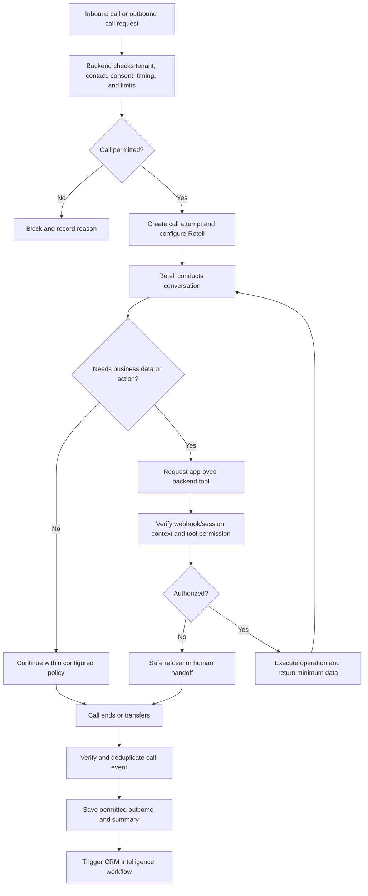

**Responsibilities**
- Handle voice conversations through Retell.
- Collect requirements and answer from verified information.
- Request property searches or appointment actions through approved tools.
- Transfer to a human when requested or when the request exceeds the agent's authority.
- Persist call outcome and structured summary.
- Trigger CRM and follow-up processing.

**Possible tools:** `get_lead_context`, `search_properties`, `get_property_details`, `get_agent_availability`, `request_appointment`, `create_human_handoff`, `record_call_outcome`.

**Security:** Verify Retell webhook signatures using current provider documentation. Associate calls with server-created context. A lead ID supplied by a caller is not proof of identity. Check consent and applicable calling rules before outbound calls. Do not confirm a booking until the backend has persisted it.

**Autonomy:** High within approved conversation flows; human handoff for complaints, uncertain claims, unusual negotiations, legal/contractual questions, or restricted actions.

## Agent 3 — AI Sales and Qualification Agent

**Mission:** Convert conversations and form submissions into structured requirements and an appropriate next action.

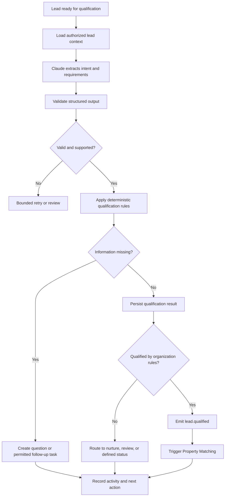

**Responsibilities**
- Classify buy/sell/rent/invest intent.
- Extract budget, location, property type, bedrooms, timing, and preferences.
- Identify missing or contradictory details.
- Apply organization-specific qualification rules.
- Distinguish stated facts from inference.
- Recommend the next action.

**Possible tools:** `get_lead_context`, `get_qualification_rules`, `save_qualification_result`, `create_follow_up_task`, `create_activity`, `emit_business_event`.

**Autonomy:** High for extraction and routine classification; escalate uncertainty or contradictions. Model confidence is a signal, not proof.

## Agent 4 — AI Property Matching Agent

**Mission:** Find and explain relevant properties using real, current inventory.

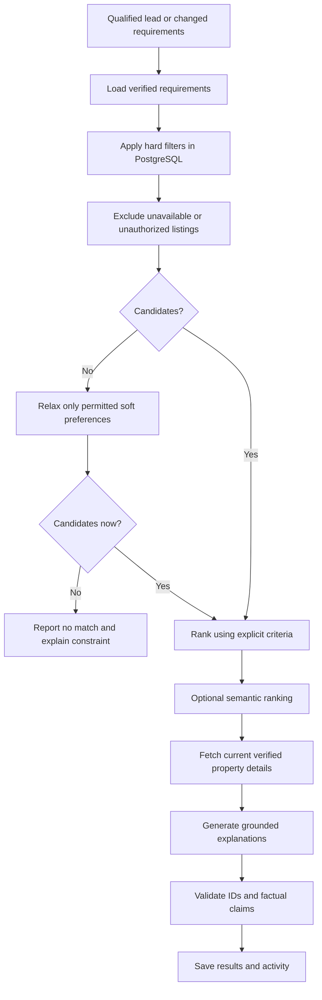

**Responsibilities**
- Apply hard constraints for budget, location, property type, bedrooms, and status.
- Rank candidates using transparent criteria.
- Optionally use semantic search for soft preferences.
- Explain matches using retrieved facts.
- Identify trade-offs honestly.
- Exclude unavailable listings.

**Possible tools:** `search_available_properties`, `get_property_details`, `get_property_availability`, `save_property_matches`, `create_activity`.

**Autonomy:** High for search/ranking. Never invent properties, prices, amenities, or availability.

## Agent 5 — AI Follow-Up Agent

**Mission:** Coordinate useful follow-ups while respecting contact preferences and communication policy.

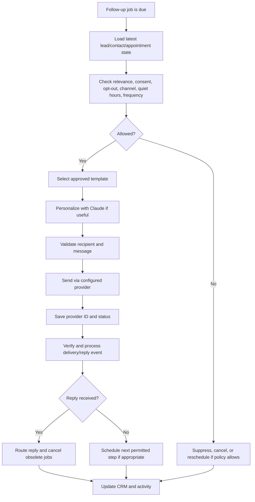

**Responsibilities**
- Schedule and cancel follow-ups.
- Personalize approved templates using verified data.
- Enforce quiet hours, consent, opt-outs, and frequency limits.
- Track provider delivery states.
- Route replies to qualification, CRM, or a human.
- Prevent duplicate messages during retries.

**Possible tools:** `get_contact_preferences`, `get_lead_state`, `check_communication_policy`, `render_approved_template`, `send_email`, `send_whatsapp_message`, `send_sms`, `schedule_job`, `cancel_jobs_for_lead`, `record_message_outcome`.

**Autonomy:** High only within configured policies. The LLM cannot decide that consent exists or override an opt-out.

## Agent 6 — AI Appointment Agent

**Mission:** Book, reschedule, cancel, and remind people about viewings without double-booking.

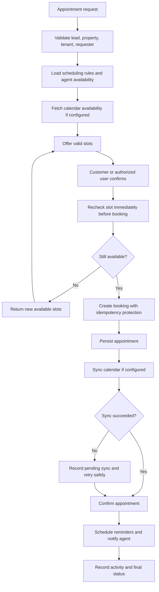

**Responsibilities**
- Retrieve valid availability and offer slots.
- Revalidate before committing.
- Persist bookings before confirming.
- Synchronize calendars safely.
- Send confirmations and reminders through permitted channels.
- Handle cancellation, rescheduling, and conflicts.

**Possible tools:** `get_agent_availability`, `get_calendar_availability`, `create_appointment`, `reschedule_appointment`, `cancel_appointment`, `sync_calendar_event`, `schedule_appointment_reminder`, `create_activity`.

**Autonomy:** High for routine bookings after conflict and idempotency protections are tested.

## Agent 7 — AI CRM and Data Intelligence Agent

**Mission:** Keep CRM records useful, traceable, and consistent.

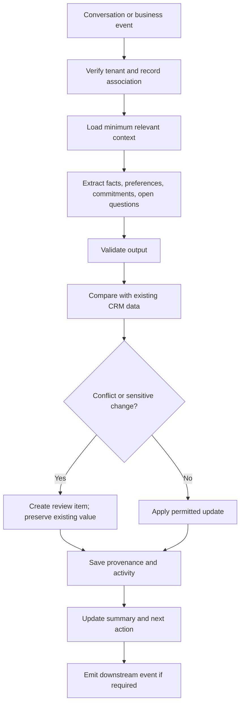

**Responsibilities**
- Summarize calls and messages.
- Extract stated preferences and outcomes.
- Suggest or apply low-risk CRM updates.
- Preserve source and timestamps.
- Identify missing or contradictory information.
- Create useful handoff summaries.
- Avoid silently overwriting important fields based on inference.

**Possible tools:** `get_lead_context`, `get_contact`, `get_recent_activities`, `update_permitted_crm_fields`, `create_activity`, `create_review_item`, `save_conversation_summary`.

**Autonomy:** High for summaries and low-risk updates; review conflicting, sensitive, or consequential changes.

## Agent 8 — AI Sales Intelligence Agent

**Mission:** Identify pipeline risks and recommend actions using actual business data.

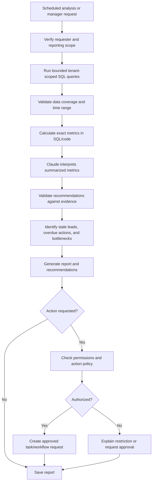

**Responsibilities**
- Identify stale leads and overdue follow-ups.
- Find qualified leads without viewings.
- Calculate pipeline and conversion metrics.
- Explain bottlenecks based on evidence.
- Generate daily/weekly reports.
- Recommend next steps without silently changing consequential records.

**Possible tools:** `get_pipeline_metrics`, `get_stale_leads`, `get_overdue_tasks`, `get_conversion_metrics`, `create_task`, `save_report`, `request_approval`.

**Autonomy:** High for analysis/reporting; restricted execution for consequential actions.

# 5. Agent orchestrator and workflow engine

The orchestrator is shared code, not necessarily a ninth LLM agent. It runs predefined workflows, routes events, maintains state, and invokes specialized agents only when appropriate.

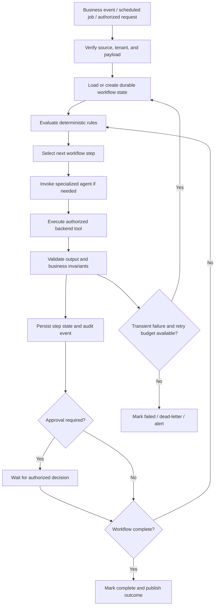

**Rules**
- Use deterministic transitions for predictable operations.
- Persist workflow state so workers can resume after a crash.
- Use timeouts, bounded retries, cancellation, and idempotency keys.
- Prevent concurrent workers from repeating the same side effect.
- Separate model proposals from actions actually executed.
- Recheck authorization when an action executes, even if the workflow began earlier.

# 6. Primary end-to-end workflow: New lead to property viewing

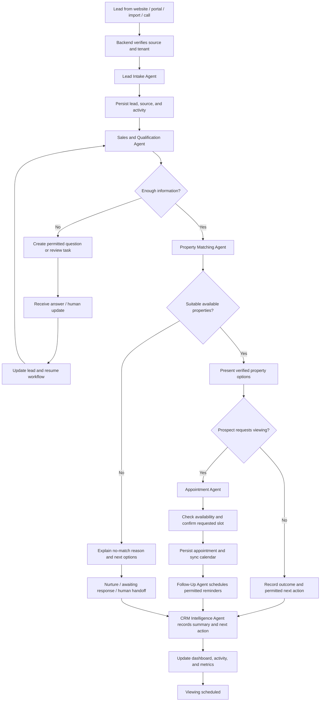

### Step-by-step

1. Backend validates the incoming lead event and organization.
2. Lead Intake validates, normalizes, and deduplicates the record.
3. Qualification extracts requirements and identifies missing information.
4. If key information is missing, create a permitted next action; do not invent an answer.
5. Property Matching searches current inventory.
6. Present verified matches through an authorized channel or agency user.
7. If a viewing is requested, Appointment Agent checks current availability.
8. Persist the booking before confirming it.
9. Schedule permitted reminders.
10. CRM Intelligence saves a summary and next action.
11. The frontend reads the current database state.

The workflow can pause for a customer response or approval. It must resume from persisted state, not restart completed steps.

# 7. Retell voice integration workflow

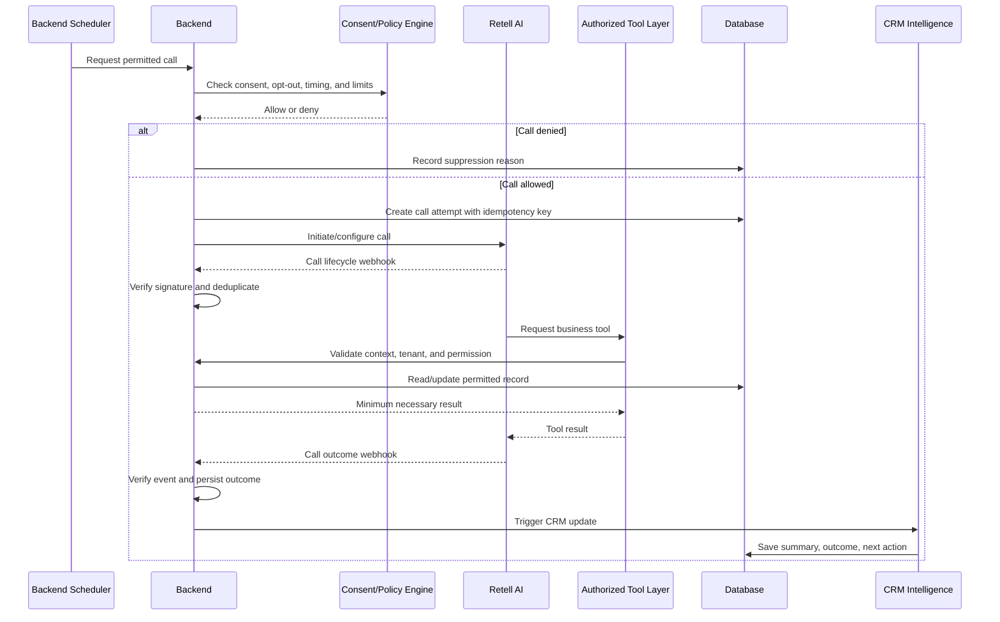

Retell is the voice platform, not the source of truth for OS data. Verify webhooks using current provider documentation, deduplicate events, and use a server-created call/session context. Do not assume every call turn needs a separate Claude API request; select the supported Retell configuration based on latency, tool-use, quality, and cost requirements.

# 8. Follow-up and messaging workflow

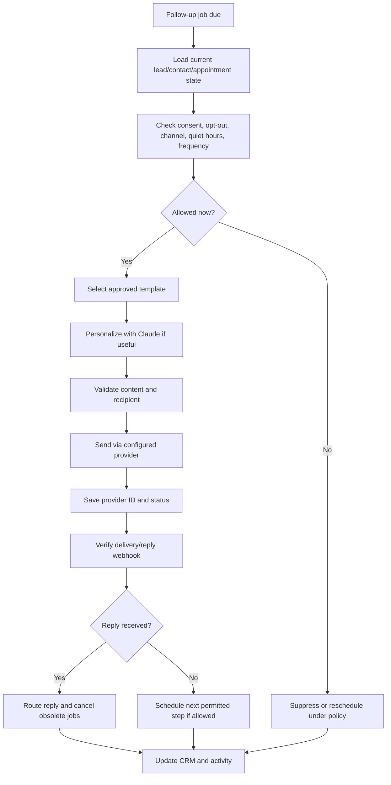

A provider accepting a request does not necessarily mean the message was delivered. Track provider status where available. Do not retry permanent failures indefinitely.

# 9. Human approval workflow

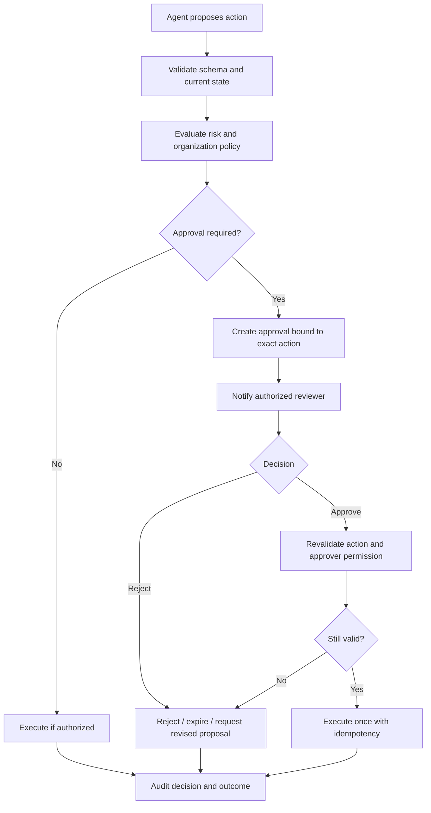

If the proposed action changes after approval, require a new approval. Approval does not replace normal authorization checks.

# 10. Suggested data entities

Inspect the current schema before adding tables. Reuse equivalents.

| Entity | Purpose |
|---|---|
| `ai_agents` | Agent definitions, enabled state, scope |
| `agent_versions` | Versioned instructions, model configuration, tool allowlist |
| `agent_runs` | Execution status, timestamps, outcome/error metadata |
| `agent_steps` | Workflow steps and tool-call records |
| `workflow_definitions` | Versioned workflow steps and triggers |
| `workflow_runs` | Durable workflow state and current step |
| `scheduled_jobs` | Due time, status, idempotency key |
| `human_approvals` | Proposed action, requester, reviewer, decision |
| `integration_events` | Provider event IDs and processing status |
| `outbox_events` | Reliable business event delivery |
| `agent_evaluations` | Test scenario, agent version, result |

Reuse existing lead, contact, property, appointment, task, activity, message, and audit entities. Avoid copying entire customer records into agent logs. Minimize personal data in prompts and telemetry. Define retention and deletion rules for transcripts, summaries, and memory.

# 11. Shared tool and permission model

| Category | Example tools | Controls |
|---|---|---|
| CRM read | `get_lead`, `get_contact`, `get_recent_activities` | Tenant scope, minimum fields |
| CRM write | `update_lead`, `create_activity` | Field allowlist, permission, audit |
| Property search | `search_available_properties`, `get_property_details` | Verified inventory and tenant scope |
| Appointments | `get_agent_availability`, `create_appointment` | Recheck availability, idempotency |
| Communications | `send_approved_message`, `initiate_permitted_call` | Consent, opt-out, frequency, policy |
| Scheduling | `schedule_job`, `cancel_job` | Tenant scope, deduplication |
| Human review | `create_human_handoff`, `request_approval` | Reviewer authorization, audit |
| Analytics | `get_pipeline_metrics`, `get_stale_leads` | Bounded query, exact calculations |

Never expose generic `execute_sql` or arbitrary HTTP/shell tools to agents. The LLM cannot grant itself permissions or bypass server authorization.

# 12. Reliability and failure handling

| Failure | Expected behavior |
|---|---|
| Invalid event | Reject or quarantine; record safe reason |
| Duplicate webhook | Acknowledge safely without repeating side effects |
| Model timeout | Bounded retry, then fail or escalate |
| Invalid model output | Reject schema; bounded retry or review |
| Provider rate limit | Follow provider guidance and bounded backoff |
| Database error | Roll back where possible; retry only if safe |
| Appointment conflict | Refresh availability and offer alternatives |
| Message failure | Record provider status; retry only if appropriate |
| Opt-out | Suppress prohibited future communications and cancel relevant jobs |
| Missing credentials | Mark integration unconfigured; never fake success |
| Worker crash | Resume durable state without repeating completed effects |
| Expired approval | Do not execute; request fresh approval |
| Tenant mismatch | Deny and record a security event |
| Repeated failure | Stop retries, mark terminal failure, alert operator |

Use timeouts, bounded retries, backoff with jitter where appropriate, dead-letter handling, and operator-visible statuses.

# 13. Autonomy levels

| Level | Behavior | Example |
|---|---|---|
| Assisted | Suggests action for a person | Draft a sales reply |
| Controlled autonomy | Executes routine permitted actions | Update a lead or send a permitted reminder |
| High autonomy | Completes a defined workflow within policy | Qualify lead, match properties, request viewing |

Recommended initial policies:

- Lead Intake: high autonomy for normalization and routing.
- Voice: controlled autonomy; outbound calls only after compliance and quality checks.
- Qualification: high autonomy for extraction; escalate uncertainty.
- Property Matching: high autonomy for database-backed search and ranking.
- Follow-Up: controlled autonomy until communication policy and provider handling are proven.
- Appointment: high autonomy after conflict and idempotency tests pass.
- CRM Intelligence: high autonomy for summaries; review conflicts and sensitive changes.
- Sales Intelligence: high autonomy for reports; restrict consequential execution.

# 14. Suggested events and event contract

Possible event types:

```text
lead.created
lead.updated
lead.ready_for_qualification
lead.qualified
lead.needs_more_information
property.matches_found
property.no_matches_found
appointment.requested
appointment.created
appointment.rescheduled
appointment.cancelled
communication.reply_received
communication.opted_out
call.completed
agent.run.completed
agent.run.failed
approval.requested
approval.decided
```

Example event envelope:

```json
{
  "event_id": "unique-event-id",
  "event_type": "lead.created",
  "schema_version": 1,
  "occurred_at": "2026-10-25T12:00:00Z",
  "organization_id": "organization-uuid",
  "record_type": "lead",
  "record_id": "lead-uuid",
  "correlation_id": "workflow-correlation-id"
}
```

Values are illustrative. A worker must verify the trusted event source and referenced record. `organization_id` alone is not authorization. Include only the minimum data needed in event payloads.

# 15. Agent monitoring in the OS frontend

Recommended AI Operations screens:

- Agent status, enabled state, version, and configuration
- Active, queued, completed, and failed runs
- Workflow step timeline
- Tool calls and sanitized results
- Approval queue
- Scheduled jobs and retry state
- Provider/webhook health
- Token usage and estimated cost
- Latency, error rate, and success rate
- Business outcomes: qualification rate, viewing bookings, follow-up completion
- Dead-letter queue and alerts

Restrict access to prompts, transcripts, and private customer data. Show the difference between a proposed action, an approved action, and an action actually executed.

# 16. Implementation roadmap

## Phase 1 — Architecture alignment
- Audit the repository and current documentation.
- Map existing APIs, tables, auth, and RLS.
- Confirm event and integration boundaries.
- Deliver `docs/AI_AGENT_ARCHITECTURE.md`.

## Phase 2 — Shared runtime
- Agent registry and versions
- Claude API adapter
- Typed tool registry and server-side permissions
- Agent run persistence
- Background workers and scheduler
- Retries, timeouts, idempotency, cancellation
- Audit logs, observability, approvals

## Phase 3 — First end-to-end workflow
Implement:
`Lead Created → Intake → Qualification → Property Matching → Appointment Request → CRM Update`

Initially do not send external marketing messages automatically.

## Phase 4 — Appointments and follow-ups
- Booking conflict handling
- Calendar sync if needed
- Scheduled reminders
- Delivery tracking
- Consent and opt-out enforcement
- Duplicate-send protection

## Phase 5 — Retell voice integration
- Inbound and permitted outbound calls
- Verified webhooks
- Authorized tools
- Call outcome persistence
- Human handoff
- CRM summary workflow
- Call policy and retention controls

## Phase 6 — CRM and sales intelligence
- Conversation summaries
- Data-quality checks
- Stale-lead analysis
- Pipeline reports
- Evaluation datasets

## Phase 7 — Controlled pilot
- Test internally
- Test cross-tenant isolation
- Evaluate model output quality
- Review call/message quality
- Measure qualification and booking outcomes
- Increase autonomy gradually with rollback and disable controls

# 17. Definition of done

- [ ] Frontend requests use authenticated backend APIs.
- [ ] Server-side permissions and tenant isolation are enforced.
- [ ] All eight agents have documented responsibilities and validated contracts.
- [ ] Shared runtime persists execution state.
- [ ] Agents can use only registered and authorized tools.
- [ ] Background work runs without a browser session.
- [ ] Duplicate events do not duplicate side effects.
- [ ] Retries, timeouts, cancellation, and failures are observable.
- [ ] Lead intake and qualification work end to end.
- [ ] Property matching uses verified inventory.
- [ ] Appointment booking rechecks availability and prevents duplicates.
- [ ] Communication policies are checked before outbound contact.
- [ ] Retell webhooks are verified and deduplicated.
- [ ] Required approvals are enforced server-side.
- [ ] Runs, tool calls, approvals, and outcomes are auditable.
- [ ] Tests cover tenant isolation, invalid output, retries, and restricted actions.
- [ ] Existing frontend and backend still work.
- [ ] Limitations and external setup are documented.

Do not mark a feature complete merely because its prompt or UI exists. Verify behavior, integration, security, and tests.

# 18. Instructions for Claude Code

1. Inspect the real repository before implementing.
2. Read the existing PRD, architecture, database, security, and API documents.
3. Identify existing equivalents before adding tables, routes, or services.
4. Create an implementation plan with dependencies and acceptance criteria.
5. Implement shared runtime before all eight agents.
6. Build one complete workflow and test it end to end.
7. Reuse the current backend and frontend.
8. Use Retell for voice and provider APIs only when configured.
9. Do not use n8n, Make, Zapier, or other no-code workflow platforms.
10. Never expose secrets or weaken authorization.
11. Do not reset the database or make destructive migrations without explicit approval.
12. Do not claim tests or remote integrations succeeded without verification.
13. Implement incrementally and document blockers.
14. Report what is implemented, tested, blocked, and incomplete.

**Primary goal:** Eight specialized agents should perform authorized work through a shared, secure runtime while the backend retains control of data, permissions, communications, and consequential actions.
