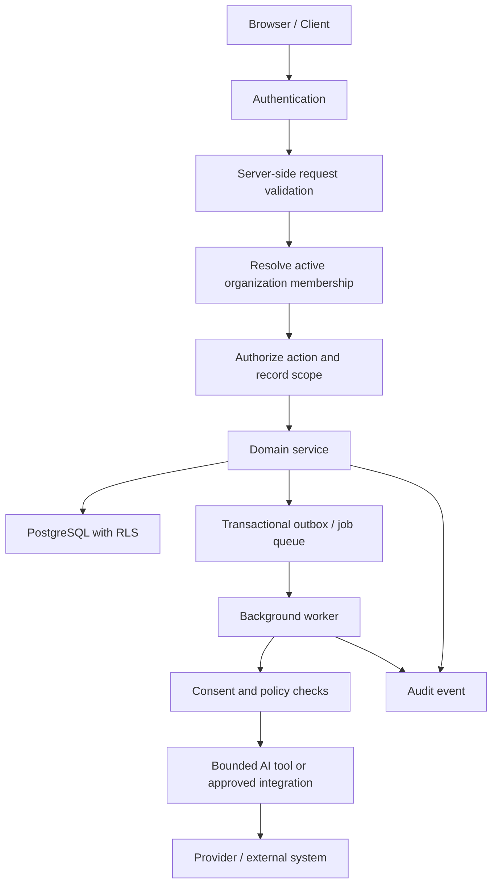

# Real Estate AI OS
# SECURITY.md

**Document type:** Application security architecture and implementation standard  
**Status:** Proposed baseline for implementation  
**Product:** Multi-tenant real estate SaaS with AI agents, communications, workflow automation, and integrations  
**Primary platform:** Next.js, TypeScript, Supabase/PostgreSQL, private object storage, background workers  
**Version:** 1.0  
**Last updated:** 2026-10-24

---

## 1. Purpose and scope

This document defines the security requirements for Real Estate AI OS. It is intended for product engineering, backend development, AI-agent implementation, DevOps, QA, and incident response.

The product processes business and personal information, including contact details, property enquiries, messages, call metadata, possible recordings and transcripts, appointment data, documents, deal information, and AI execution logs. A security failure could expose one agency's data to another, trigger unauthorized communications, alter business records, or cause an AI agent to take an unsafe action.

Security must be implemented in the database, server-side services, integrations, workers, user interface, and operational processes. A hidden button or a prompt instruction is not an access-control mechanism.

This document covers:

- Authentication, sessions, authorization, and tenant isolation
- PostgreSQL Row-Level Security (RLS) and Supabase Storage policies
- API security and validation
- AI-agent security, prompt injection, and tool permissions
- Consent, outbound communications, and human approval
- Secrets, integrations, webhooks, and background jobs
- File uploads, document processing, and sensitive data
- Logging, audit trails, monitoring, and incident response
- Secure development, testing, deployment, and recovery

This is an engineering baseline, not legal advice or a certification. Before production, assess the applicable privacy, data-protection, telemarketing, recording-consent, real-estate, and communications rules for each target market.

---

## 2. Security objectives

### 2.1 Core objectives

1. **Confidentiality:** Users can access only records and files they are authorized to access.
2. **Integrity:** Business-critical changes are validated, attributable, and resistant to unauthorized modification.
3. **Availability:** The product can tolerate common failures, abuse, provider outages, and recoverable operational incidents.
4. **Tenant isolation:** One organization's users, agents, API keys, jobs, and integrations cannot access another organization's data.
5. **Least privilege:** Each user, service, worker, AI agent, and integration receives only the permissions needed for its job.
6. **Human control:** Consequential AI actions have explicit permission boundaries, approvals where required, and reliable stop mechanisms.
7. **Accountability:** Sensitive operations create useful audit records without logging secrets or unnecessary personal information.
8. **Privacy by design:** Collect, expose, process, and retain only the information required for the feature.
9. **Defense in depth:** Security does not depend on one control, such as a system prompt, UI check, or RLS policy alone.
10. **Recoverability:** Backups, recovery procedures, key rotation, and incident response are tested.

### 2.2 Security is a release requirement

A feature is not production-ready until its access rules, failure modes, audit requirements, data retention, and abuse cases have been tested. Product functionality must not be considered complete if security controls are deferred without an explicit, approved risk decision.

---

## 3. Threat model

### 3.1 Assets to protect

| Asset | Examples | Primary risks |
|---|---|---|
| Tenant data | Contacts, leads, properties, deals | Cross-tenant disclosure or modification |
| User identities | Accounts, sessions, invitations | Account takeover, privilege escalation |
| Communication data | Messages, call logs, recordings, transcripts | Privacy breach, unauthorized access |
| AI execution | Prompts, tool calls, outputs, approvals | Prompt injection, unsafe actions, data exfiltration |
| Provider credentials | Telephony, email, calendar, AI API keys | Account compromise, unauthorized use |
| Documents | Contracts, IDs, property records | Malware, unauthorized download, extraction errors |
| Financial records | Offers, commissions, payment tracking | Fraud, unauthorized edits, inaccurate calculations |
| Automation infrastructure | Webhooks, workers, job queues | Replay, forged events, duplicate side effects |
| Audit and logs | Security events, activity history | Tampering, leakage, insufficient evidence |
| Service availability | Database, APIs, workers | Denial of service, runaway usage, queue exhaustion |

### 3.2 Threat actors

- Unauthenticated internet users probing public endpoints
- Malicious or compromised tenant users
- Users attempting to access another organization's records
- Stolen or leaked API keys and provider credentials
- Malicious content submitted in emails, chat messages, property descriptions, documents, or web pages
- Compromised or misconfigured external providers
- Automated abuse, spam, credential stuffing, and denial-of-service attempts
- Insider misuse by staff or privileged operators
- AI agents acting on ambiguous, manipulated, or incomplete information
- Software supply-chain compromise through dependencies, build pipelines, or deployment credentials

### 3.3 Trust boundaries

Treat each of these as an untrusted or separately authorized boundary:

1. Browser and mobile clients to application APIs
2. Authenticated user to tenant/organization scope
3. Application server to database
4. Application server to AI model provider
5. AI model output to executable tools
6. Public webhooks to trusted internal events
7. Uploaded files to document parsing/OCR/embedding workers
8. Workflow engine to external providers
9. Background worker to tenant data
10. Production environment to developers and support staff

### 3.4 Abuse cases that must be tested

- A user changes `organization_id` in a request to access another agency's records.
- A user reuses an invitation after it was accepted, expired, or revoked.
- A member who has been suspended continues to use an old session or API token.
- An AI agent reads a malicious property description that instructs it to reveal CRM data or ignore policy.
- An incoming message tricks an AI agent into sending a message, exporting records, or changing a deal.
- A forged webhook creates fake leads or reports a payment as successful.
- A webhook is replayed and causes duplicate calls, messages, or appointments.
- A user uploads a malicious PDF, oversized image, or file with a misleading extension.
- A signed file URL is exposed in logs or remains valid longer than intended.
- An outbound communication is sent after the recipient opts out.
- A worker retries a job and repeats a non-idempotent side effect.
- A support operator downloads a recording without business justification.
- A tenant's API key is used to enumerate IDs belonging to another tenant.
- An export job creates a public or long-lived download link.
- An attacker abuses an AI workflow to create high-cost model or telephony usage.

---

## 4. Security architecture

### 4.1 Required layers

- **Identity layer:** Supabase Auth, secure session handling, account recovery, MFA where supported/required.
- **Application layer:** Server-side authorization, request validation, rate limiting, safe error handling.
- **Database layer:** PostgreSQL constraints, RLS, tenant-scoped queries, restricted database roles.
- **Storage layer:** Private buckets, Storage policies, short-lived signed URLs, file validation.
- **AI layer:** Bounded tools, structured output validation, least-privilege context, approval gates.
- **Integration layer:** Secret references, signed webhooks, scoped OAuth permissions, idempotency.
- **Operations layer:** Audit logs, alerts, backups, vulnerability management, incident response.

### 4.2 Recommended request flow

Every boundary needs its own validation. The AI model is not an authorization service, and the client is not a trusted source of tenant identity.

---

## 5. Authentication and account security

### 5.1 Authentication

- Use Supabase Auth or an approved identity provider. Do not implement custom password storage.
- Require verified email addresses before sensitive account actions.
- Enforce secure account recovery with short-lived, single-use recovery tokens.
- Apply rate limits to sign-in, sign-up, password reset, invitation acceptance, and MFA verification endpoints.
- Use MFA for organization owners, administrators, privileged support accounts, and production operators where supported. Strongly recommend MFA for all users.
- Provide session revocation when an account is suspended, a membership is removed, a password is reset, or compromise is suspected.
- Re-check authorization on every request. A valid session does not imply access to every tenant or record.
- Avoid revealing whether an email address exists during authentication and recovery flows.
- Notify users about important account security events where feasible.

### 5.2 Session handling

- Use the framework's secure server-side session patterns.
- Prefer `HttpOnly`, `Secure`, and appropriate `SameSite` cookies when cookie-based sessions are used.
- Do not store privileged tokens or service-role credentials in browser storage.
- Protect state-changing requests against CSRF when cookie authentication is used.
- Set reasonable session lifetimes and rotate or refresh credentials safely.
- Revoke sessions after suspected account takeover.
- Never include access tokens in URLs, analytics events, error messages, or logs.

### 5.3 Account lifecycle

- Invitations must be single-use, expire, and be stored as token hashes rather than raw tokens.
- Invite acceptance must confirm the intended user identity and organization.
- Role changes and membership removal must take effect on subsequent authorization checks.
- Deactivated staff should lose access to tenant data, connected integrations, and team resources promptly.
- Provide a documented offboarding process for employees and contractors.
- Do not allow users to promote themselves or alter their own role through ordinary profile updates.

---

## 6. Authorization and tenant isolation

### 6.1 Non-negotiable rule

**Every tenant-owned record must be authorized against the active organization membership and the specific action being performed.** A client-supplied `organization_id`, record UUID, email, or URL is not proof of authorization.

### 6.2 Server-side authorization

For every request:

1. Validate the session.
2. Resolve the target organization from the request context only after verifying membership.
3. Check membership status and role.
4. Check action-specific permissions.
5. Check record scope, including team, assignment, privacy level, and sensitivity where applicable.
6. Perform the operation through a domain service.
7. Write the required audit record.
8. Return only the fields the caller is permitted to see.

Use a centralized policy/authorization module to avoid scattered role checks. Avoid trusting frontend-provided roles or permissions.

### 6.3 Organization membership

- An active membership is required for tenant access.
- Suspended, removed, and expired memberships must fail authorization.
- Membership management is restricted to authorized roles.
- Prevent the last active owner from being removed or demoted without a safe ownership-transfer process.
- Role updates must be audited.
- Team membership does not automatically grant access to every team record unless the policy explicitly says so.

### 6.4 Supabase RLS

- Enable RLS on every tenant-owned table exposed through Supabase APIs.
- Write explicit `SELECT`, `INSERT`, `UPDATE`, and `DELETE` policies as appropriate.
- Use `USING` and `WITH CHECK` conditions to protect both existing and newly written rows.
- Ensure `organization_id` cannot be changed to bypass isolation.
- Default to no access when a policy is absent or a check fails.
- Avoid broad `FOR ALL` policies unless the full behavior is deliberate and tested.
- Treat the service-role key as a privileged bypass: use it only in trusted server-side code, never in browser bundles or public runtime configuration.
- For service-role operations, explicitly resolve tenant scope and authorize the operation in application code.
- Review `SECURITY DEFINER` functions for fixed `search_path`, minimal grants, safe SQL, and policy-recursion behavior.

### 6.5 Cross-tenant testing

Maintain automated negative tests using at least two organizations and multiple roles. Tests must prove that a user cannot read, insert into, update, delete, or infer records from another tenant through:

- Direct table/API requests
- Nested relations and joins
- Search endpoints
- Counts and analytics
- Export jobs
- Realtime subscriptions
- Storage paths and signed URL generation
- AI context retrieval and vector search
- Background jobs and webhook processing

Do not assume UUIDs make records unguessable enough to replace authorization.

### 6.6 Sensitive record classes

Apply narrower authorization to:

- Call recordings and transcripts
- Private notes
- Commission and payment records
- Integration configuration
- AI prompts and tool arguments
- Audit logs
- Data exports
- Identity or contract documents
- API key metadata

Role-based access should be combined with assignment, team, purpose, and business-need checks where required.

---

## 7. API security

### 7.1 Input validation

- Validate all inputs at the server boundary using typed schemas, such as Zod or an equivalent.
- Reject unexpected fields on sensitive mutation endpoints.
- Enforce length, size, type, range, and allowed-value constraints.
- Validate UUIDs, timestamps, currencies, URLs, phone numbers, and pagination parameters.
- Normalize phone numbers and email addresses before matching or suppression checks.
- Use parameterized database queries; never interpolate user-controlled strings into SQL.
- Validate state transitions in domain services, not only through database `CHECK` constraints.
- Use database constraints as a second line of defense.

### 7.2 Output handling

- Return only fields required by the client.
- Do not expose provider payloads, internal stack traces, secret references, private prompts, or raw tool execution output by default.
- Escape user-generated content when rendering it as HTML.
- Treat property descriptions, notes, email bodies, transcripts, and document text as untrusted content.
- Avoid including sensitive data in URLs or client-side telemetry.
- Use generic public error messages and log the detailed error securely with a correlation ID.

### 7.3 Rate limiting and abuse prevention

Apply rate limits by user, tenant, IP or network signal where appropriate, endpoint, and provider account. Use stricter limits for:

- Authentication and recovery
- Public lead capture
- Search and bulk export
- AI generation and agent execution
- Outbound calls, SMS, WhatsApp, and email
- File uploads and document processing
- Webhook retries and integration syncs
- Invitation creation and membership changes

Also implement tenant usage quotas, concurrency limits, maximum payload sizes, pagination caps, and spending limits for AI and telephony. Rate limits should account for legitimate burst traffic and should be observable.

### 7.4 CORS, CSRF, and browser protections

- Allow only known application origins in CORS configuration.
- Do not use wildcard origins with credentialed requests.
- Use CSRF protection for cookie-authenticated state-changing operations.
- Configure a Content Security Policy appropriate to the app and its required providers.
- Use secure headers, including appropriate `X-Content-Type-Options`, `Referrer-Policy`, and frame restrictions.
- Do not permit arbitrary iframe embedding of authenticated application pages.
- Avoid unsafe HTML rendering. If rich HTML is required, sanitize it with a maintained library.

### 7.5 Pagination and enumeration

- Require bounded pagination for list APIs.
- Avoid endpoints that expose arbitrary record existence across tenants.
- Use stable sorting and cursor pagination for high-volume datasets where suitable.
- Enforce tenant scope before counts, search, aggregation, or vector retrieval.
- Return consistent not-found/forbidden behavior where revealing existence would be a concern.

---

## 8. AI-agent security

AI agents are privileged application features, not trusted principals. Model output must never directly authorize or execute a sensitive action.

### 8.1 Core rule

**The model proposes; deterministic application code validates, authorizes, and executes.**

### 8.2 Tool registry

Every tool must have:

- A stable name and version
- A typed input schema
- A documented purpose
- An explicit list of allowed agent types/roles
- A tenant and record-scope check
- A defined side-effect classification
- A timeout and resource limit
- An idempotency strategy for side effects
- Structured output with sensitive fields removed
- An audit event
- Tests for invalid input, cross-tenant access, and failure cases

Do not provide generic tools for arbitrary SQL, shell execution, unrestricted filesystem access, arbitrary code execution, or unrestricted network requests.

### 8.3 Tool risk categories

| Risk class | Examples | Default control |
|---|---|---|
| Read-only, low risk | Read permitted lead fields, search active properties | Allow only after authorization and scope validation |
| Internal reversible change | Add task, draft note, update non-critical metadata | Allow only within explicit agent permissions; audit |
| External communication | Send email/message, place call | Check consent, suppression, templates, limits, and agent policy; approval based on configuration |
| Business-critical change | Change deal stage, assign ownership, update offer | Validate transition and require approval where configured |
| High impact | Export bulk data, modify commission, delete records, change permissions | Human approval and privileged server-side authorization |
| Prohibited by default | Exfiltrate tenant data, bypass opt-out, access another tenant | Deny; do not expose a tool for this action |

### 8.4 Prompt injection and untrusted content

Potential injection sources include inbound messages, email bodies, call transcripts, uploaded documents, property descriptions, scraped web pages, and integration payloads.

Required controls:

- Clearly label retrieved or user-supplied content as untrusted data.
- Do not treat instructions inside external content as system policy or authorization.
- Keep secrets and unrelated tenant records out of model context.
- Retrieve only the minimum relevant fields for the current task.
- Separate policy instructions from data and use structured tool calls.
- Validate all model outputs against schemas and allowed values.
- Do not allow the model to select an arbitrary tenant, storage path, database query, or destination URL.
- Use allowlisted destinations for outbound integrations and network access.
- Detect and block attempts to override safety rules, reveal secrets, or perform unauthorized actions.
- Require approval for sensitive operations even when the model confidently recommends them.
- Test indirect prompt injection, encoded instructions, multilingual attempts, and instructions embedded in documents or transcripts.

Prompt wording is a helpful defense but is not a security boundary.

### 8.5 Context minimization and data leakage

- Build context from authorized database queries, not broad table dumps.
- Exclude secrets, authentication tokens, unnecessary personal information, and unrelated conversations.
- Apply tenant and record authorization before retrieval, including vector search.
- Redact or mask sensitive fields where the task does not require them.
- Define provider retention and training/data-use terms before sending customer data to a model provider.
- Do not put customer data into model prompts used for debugging or analytics without an approved purpose and retention policy.
- Avoid storing hidden chain-of-thought. Keep structured decisions, concise summaries, tool inputs/outputs required for audit, and policy outcomes.

### 8.6 Agent autonomy and approvals

- Default new agents to `suggest_only` or an equivalent low-autonomy mode.
- Configure autonomy per agent, tool, tenant, and action type.
- Use an approval record that binds to the exact action, target, payload hash or immutable payload, expiry, and requesting actor.
- Revalidate authorization, consent, target state, and approval expiry immediately before execution.
- If the payload changes, invalidate the prior approval and request a new one.
- Never treat an approval as permission to bypass a later opt-out, revoked membership, or changed business rule.
- Support pause/disable controls for individual agents and a tenant-wide kill switch.
- Enforce per-run step limits, runtime limits, concurrency limits, and daily cost budgets.
- Prevent infinite loops and recursive agent-triggering workflows.

### 8.7 AI evaluation and release

Before enabling an agent for real customers, run a test suite covering:

- Cross-tenant retrieval attempts
- Prompt injection in all supported input channels
- Unauthorized tool calls
- Hallucinated property facts and unsupported promises
- Incorrect contact identity or lead matching
- Opt-out and consent enforcement
- Approval bypass attempts
- Duplicate side effects on retry
- PII leakage in summaries and logs
- Tool timeout and provider failure
- Human handoff and emergency stop

Start in shadow or suggestion mode, review outcomes, then gradually enable bounded automation.

---

## 9. Outbound communications and consent

### 9.1 Mandatory pre-send gate

Before every outbound call, SMS, WhatsApp message, or email, evaluate a deterministic server-side policy:

1. Confirm the requesting user/agent/workflow is authorized.
2. Resolve the intended recipient from a trusted contact record.
3. Check current channel- and purpose-specific consent.
4. Check organization and contact suppression entries.
5. Check applicable provider rules, template approval, quiet hours, and local legal restrictions.
6. Check message/call frequency limits and tenant budget.
7. Confirm required approval is present and unexpired.
8. Validate content, recipient, and template variables.
9. Write an auditable execution record and use an idempotency key.
10. Execute through the approved provider and process callbacks idempotently.

Unknown consent must not be treated as permission. An opt-out must take effect across AI agents, scheduled workflows, retries, and manual sending flows as required by policy.

### 9.2 Stop and opt-out handling

- Provide a reliable way to pause outbound activity per contact, channel, tenant, agent, or integration.
- Treat recognized opt-out messages as a priority control path.
- Store the opt-out evidence and time.
- Cancel pending sends where possible.
- Re-check suppression immediately before dispatch, not only when a job is queued.
- Ensure retries do not send after consent is revoked.
- Test stop controls during provider outages and queued job execution.

### 9.3 Call recording and transcripts

- Confirm the legal basis and required notice/consent for recording in the relevant jurisdiction.
- Track recording-consent status and relevant evidence.
- Restrict recording and transcript access to authorized users with a business need.
- Store recordings in private storage with short-lived signed URLs.
- Define retention, deletion, and legal-hold policies.
- Avoid sending entire recordings/transcripts to an AI model when a minimal excerpt or summary is sufficient.
- Redact sensitive information from transcripts where feasible.
- Do not infer protected or sensitive personal traits from calls.

---

## 10. Secrets and configuration

### 10.1 Secret storage

Store provider secrets in Supabase Vault or a managed secrets manager. Ordinary database records may contain a secret reference or connection status, but not the secret itself.

Examples of secrets:

- Supabase service-role key
- AI provider API keys
- Telephony credentials
- WhatsApp or email provider credentials
- OAuth refresh tokens
- Webhook signing secrets
- Encryption keys
- Third-party API tokens

### 10.2 Secret handling rules

- Never place secrets in source code, Git history, prompts, issue trackers, screenshots, logs, or client bundles.
- Keep separate credentials for development, staging, and production.
- Restrict production secret access to the smallest necessary set of services and operators.
- Rotate secrets after suspected exposure, staff offboarding, or provider compromise.
- Prefer short-lived credentials and scoped tokens when available.
- Use automated secret scanning in the repository and CI pipeline.
- Document ownership, purpose, environment, rotation method, and revocation procedure for each secret.
- Avoid printing environment variables during build or deployment.
- Do not return secrets from settings APIs after creation; show a credential once only when the product explicitly supports API key generation.

### 10.3 API keys issued to customers

If tenant API keys are supported:

- Generate high-entropy random keys.
- Display the raw secret only once.
- Store only a cryptographic hash plus a non-secret prefix for identification.
- Assign narrow scopes and optional expiry.
- Support immediate revocation and last-used tracking.
- Rate-limit and audit key use.
- Never use customer API keys as a substitute for user identity when a user-level action is required.

---

## 11. Integrations and webhooks

### 11.1 Webhook verification

- Verify provider signatures using the official signing scheme and the raw request body where required.
- Compare signatures in constant time where applicable.
- Reject invalid, missing, expired, or malformed signatures.
- Validate timestamp/replay windows when supported.
- Resolve the tenant from a trusted integration mapping after signature verification.
- Do not trust a tenant ID supplied by an unverified payload.
- Store a minimal, redacted event record and return a response that avoids leaking internal details.
- Process webhooks asynchronously when the provider's response window is short.

### 11.2 Idempotency and replay protection

- Enforce a unique provider event ID where the provider supplies a stable one.
- Use idempotency keys for actions that create messages, calls, appointments, or payments.
- Record processing state and retry count.
- Distinguish a duplicate event from a new event with similar content.
- Use bounded retry policies with backoff and a dead-letter or manual-review path.
- Do not mark an external side effect successful solely because a job was enqueued.

### 11.3 OAuth integrations

- Request the minimum required scopes.
- Keep access and refresh tokens in a protected secret store.
- Use OAuth `state` and PKCE where applicable.
- Validate redirect URIs against an allowlist.
- Encrypt and protect token references and metadata.
- Handle revoked or expired access by pausing sync and notifying authorized users.
- Support disconnecting an integration and revoking provider access.
- Avoid broad access to all calendars, mailboxes, or files when a narrower scope is available.

### 11.4 SSRF and outbound requests

If the backend fetches a URL from a user, model, document, or integration:

- Prefer provider-specific APIs over arbitrary URL fetches.
- Allowlist destination hosts and schemes.
- Block loopback, private, link-local, metadata-service, and internal network addresses.
- Resolve and revalidate DNS at connection time to reduce DNS-rebinding risk.
- Restrict redirects and revalidate each redirect destination.
- Apply response-size, timeout, content-type, and connection limits.
- Never permit a model to submit an unrestricted URL to a privileged fetch tool.
- Keep fetch workers isolated from internal admin networks and metadata endpoints.

---

## 12. File uploads and document processing

### 12.1 Upload controls

- Use private Storage buckets by default.
- Enforce file-size limits, file-count limits, and allowed content types.
- Validate both file extension and detected file signature; neither alone is sufficient.
- Generate server-side storage paths rather than accepting arbitrary object paths from clients.
- Use random object names and avoid personal information in paths.
- Scan files for malware where feasible before making them available for processing.
- Quarantine suspicious or unscanned files.
- Do not execute uploaded content.
- Limit archive expansion, parser recursion, page counts, image dimensions, and processing time to mitigate resource exhaustion.
- Prevent SVG or HTML uploads from being served inline from an authenticated application origin unless safely sanitized and isolated.

### 12.2 Document processing and RAG

- Run parsers, OCR, and embedding generation in isolated workers with resource limits.
- Treat document text as untrusted input and potential prompt injection.
- Never let extracted text define access permissions or select a tenant.
- Validate extracted values before updating CRM, property, or deal records.
- Preserve source document, extraction version, confidence, and review status.
- Enforce tenant filters before vector similarity search and before returning chunks.
- Avoid mixing embeddings from incompatible models.
- Delete derived chunks and embeddings when their source data must be deleted, subject to approved retention requirements.
- Restrict document download and signed URL generation through the same authorization model as the parent record.

### 12.3 Signed URLs

- Generate signed URLs only on the server after authorization.
- Use short expiry periods appropriate to the task.
- Never log full signed URLs.
- Do not use public buckets for contracts, transcripts, identity documents, or other private content.
- Consider one-time or proxy-based download flows for highly sensitive documents.
- Revoke access by changing storage permissions or removing objects; do not assume an already-issued signed URL can be invalidated immediately.

---

## 13. Database and data protection

### 13.1 Database controls

- Use least-privilege database roles.
- Keep migrations in version control and apply them through a controlled deployment pipeline.
- Enforce tenant isolation with RLS and server-side authorization.
- Use foreign keys, unique constraints, check constraints, and transactions to protect integrity.
- Avoid dynamic SQL built from user input.
- Restrict direct production database access.
- Audit privileged schema and data changes.
- Use separate projects or isolated environments for development, staging, and production.
- Never use production personal data in local development unless specifically approved and appropriately protected.

### 13.2 Sensitive data classification

| Classification | Examples | Minimum handling |
|---|---|---|
| Public | Public property listing fields intentionally published | Integrity checks; safe rendering |
| Internal | Workflow metadata, internal tasks | Authenticated tenant access |
| Confidential | Contact details, private notes, messages, deals | Tenant/role authorization, minimized exposure |
| Restricted | Recordings, transcripts, identity/contract documents, integration credentials | Narrow access, audit, explicit retention, protected storage |

Classification should be configurable and validated for actual market requirements. A field's classification may depend on context and jurisdiction.

### 13.3 Encryption

- Use TLS for network connections to the application, database, storage, and providers.
- Use platform-managed encryption at rest for databases, backups, and object storage.
- Use application-level encryption for selected fields only where a defined threat model requires it; manage keys separately from data.
- Do not invent custom cryptographic algorithms.
- Document which systems hold plaintext during processing and who can access those systems.
- Treat encryption as complementary to authorization, not a replacement for it.

### 13.4 Data minimization

- Collect only fields needed for a clear business purpose.
- Avoid storing identity documents or sensitive data unless the feature requires them.
- Avoid inferring protected characteristics for lead scoring, property matching, or marketing.
- Send only necessary fields to AI and external providers.
- Mask personal data in development, analytics, and support tooling.
- Define retention schedules by data category and market.
- Ensure export and deletion workflows include object storage, derived data, search indexes, AI embeddings, and external processors where applicable.

### 13.5 Backups and deletion

- Configure managed backups and point-in-time recovery where available and appropriate.
- Restrict backup access.
- Test restore procedures on a schedule.
- Document recovery point objective (RPO) and recovery time objective (RTO).
- Recognize that deletion from the live database may not immediately remove data from backups; document backup expiry and legal handling.
- Audit exports and deletion jobs.
- Do not make a deletion claim until the defined deletion workflow has completed and any permitted retention exceptions are recorded.

---

## 14. Audit logging and monitoring

### 14.1 Events to audit

At minimum, record:

- Login/security events where available
- Membership invitations, role changes, suspension, and removal
- Tenant settings and integration changes
- Bulk exports and sensitive downloads
- Contact, lead, property, deal, offer, commission, and payment mutations
- AI agent activation, configuration, and autonomy changes
- AI tool calls and approval decisions
- Outbound communication attempts and policy outcomes
- Consent grants, revocations, and suppression changes
- Webhook signature failures and replay detections
- API key creation, use metadata, rotation, and revocation
- Data deletion and export jobs
- Privileged support or production access
- Security configuration and migration changes

### 14.2 Audit log requirements

- Append-only for ordinary application roles.
- Include actor type, actor ID when available, organization, action, entity, timestamp, request/correlation ID, and outcome.
- Store minimal before/after snapshots needed to understand the change.
- Redact secrets and unnecessary personal data.
- Restrict audit log access to authorized administrators/security roles.
- Alert on unexpected access patterns or repeated policy failures.
- Consider exporting security-critical logs to a separately controlled destination.
- Define retention and tamper-evidence requirements.

### 14.3 Application observability

- Use structured logs with request IDs and trace IDs.
- Track authorization failures, webhook failures, queue delays, AI tool failures, consent blocks, unusual export activity, and provider spend.
- Alert on sudden spikes in calls/messages, AI cost, failed logins, or denied cross-tenant requests.
- Keep metrics and traces free of message bodies, secrets, and unnecessary personal data.
- Separate operational logs from business audit records.
- Restrict access to monitoring platforms and apply retention settings.

---

## 15. Availability, resource controls, and resilience

- Apply request, connection, and execution timeouts.
- Use bounded retries with exponential backoff and jitter.
- Set maximum job attempts and a manual-review/dead-letter path.
- Use circuit breakers or pause switches for failing external providers.
- Apply per-tenant quotas for AI tokens, voice minutes, messages, file processing, and bulk exports.
- Cap agent steps, runtime, concurrency, and cost per run.
- Limit file size, parsing depth, query complexity, and bulk operations.
- Use queue backpressure rather than allowing unlimited job growth.
- Prevent one tenant from exhausting shared worker capacity.
- Make side-effecting jobs idempotent.
- Define degraded modes when AI or communication providers are unavailable.
- Keep critical human workflows usable if AI services are disabled.

---

## 16. Frontend security

- Never place Supabase service-role credentials or provider secrets in frontend environment variables.
- Treat every browser field, query parameter, local storage value, and hidden input as untrusted.
- Enforce authorization on the server even if the UI hides actions.
- Sanitize rich text and escape content in HTML contexts.
- Avoid unsafe DOM injection and unsafe markdown rendering.
- Use a Content Security Policy and secure headers.
- Avoid exposing detailed authorization or internal validation errors.
- Do not persist sensitive records in local storage unless there is a reviewed requirement.
- Protect clipboard/export/download functions for restricted data.
- Avoid including private content in client-side analytics and session replay tools.
- Use dependency updates and security checks for frontend packages.
- Do not use client-side route protection as the only protection for data APIs.

---

## 17. Secure development and supply-chain controls

### 17.1 Repository and code review

- Protect the main branch and require reviewed pull requests.
- Require tests for authorization-sensitive changes.
- Keep secrets out of Git and use secret scanning.
- Require code owners or security review for auth, RLS, AI tools, payment/commission, integrations, and data export changes.
- Document security-relevant design decisions.
- Keep dependencies pinned or lockfile-controlled and review high-risk updates.
- Remove unused endpoints, tools, feature flags, and provider permissions.

### 17.2 CI/CD

Recommended pipeline checks:

1. Formatting and linting
2. Type checking
3. Unit tests
4. Integration tests
5. RLS and tenant-isolation tests
6. Dependency vulnerability scan
7. Secret scan
8. Static application security testing (SAST)
9. Migration validation
10. Build and artifact integrity checks
11. Approval for production deployment
12. Post-deploy smoke tests and monitoring

Do not deploy if a critical security check fails without a documented, time-bound risk acceptance from an authorized owner.

### 17.3 Environment separation

- Use separate Supabase projects, credentials, provider accounts, and storage buckets for development, staging, and production.
- Keep production data out of test environments.
- Restrict production access and require MFA for privileged access.
- Use least-privilege CI identities and short-lived credentials where possible.
- Avoid sharing production secrets among developers.
- Record who can deploy, approve, and roll back production changes.

### 17.4 Dependency and vulnerability management

- Monitor application and infrastructure dependencies for known vulnerabilities.
- Prioritize actively exploited and critical issues.
- Establish patch timelines based on severity and exposure.
- Remove abandoned packages and unneeded permissions.
- Review third-party AI, telephony, messaging, analytics, and document-processing vendors for security, privacy, retention, and incident-notification terms.

---

## 18. Security testing plan

### 18.1 Required test categories

| Test category | Examples |
|---|---|
| Authentication | Recovery abuse, session revocation, MFA, brute-force rate limits |
| Authorization | Role checks, record scope, membership suspension |
| Tenant isolation | Cross-tenant CRUD, search, exports, Storage, vector retrieval |
| API security | Invalid types, oversized payloads, mass assignment, enumeration |
| Injection | SQL injection, XSS, template injection, prompt injection |
| Webhooks | Bad signatures, replay, duplicate events, malformed payloads |
| AI tools | Unauthorized actions, schema bypass, prompt injection, runaway loops |
| Communications | Opt-out, consent revoked while queued, duplicate send prevention |
| File handling | MIME spoofing, malware, parser exhaustion, unsafe SVG/HTML |
| Business logic | Invalid deal transitions, commission tampering, appointment conflicts |
| Availability | Rate-limit behavior, queue saturation, provider outage, retry storms |
| Secrets | Repository scan, browser bundle inspection, log leakage |
| Recovery | Backup restore, key rotation, incident containment |

### 18.2 Release gates

Before a production pilot:

- All high-risk endpoints have explicit authorization tests.
- Cross-tenant tests pass for database, API, Storage, exports, and AI retrieval.
- Privileged keys are absent from browser bundles and repository history.
- Webhook signature and idempotency tests pass.
- Consent and suppression gates are verified for every outbound channel.
- Approval and kill-switch paths are tested.
- Critical/high dependency findings are resolved or formally accepted.
- Backup restoration and incident escalation have been exercised.
- A human has reviewed AI behavior on representative and adversarial test cases.

### 18.3 Penetration testing

Before broad commercial launch, arrange an independent security review or penetration test focused on multi-tenant SaaS risks, RLS, API authorization, file storage, OAuth integrations, AI tool execution, and outbound communication controls. Repeat after major architecture changes or a material security incident.

---

## 19. Incident response

### 19.1 Incident categories

- Suspected cross-tenant data exposure
- Account takeover or privileged credential compromise
- Secret or API-key leakage
- Unauthorized AI action or outbound communication
- Webhook forgery or replay
- Malicious file or document-processing compromise
- Data corruption, ransomware, or destructive migration
- Significant service outage or abusive usage
- Vendor breach affecting product data

### 19.2 Initial response checklist

1. Confirm the alert and identify the affected system, tenant, data class, and time window.
2. Assign an incident lead and record the timeline in a restricted incident record.
3. Contain the issue: revoke credentials, disable the affected integration/agent, pause jobs, restrict access, or disable the affected endpoint.
4. Preserve relevant logs and evidence without unnecessarily copying sensitive data.
5. Determine which tenants, users, providers, records, and side effects may be affected.
6. Stop queued or retrying actions that could repeat the incident.
7. Restore a known-safe configuration or deploy a reviewed fix.
8. Validate containment with targeted tests.
9. Assess contractual and legal notification obligations with qualified counsel and responsible leadership.
10. Communicate through approved channels and keep a record of decisions.
11. Conduct a post-incident review and track corrective actions to completion.

### 19.3 AI-specific emergency controls

Provide the ability to:

- Disable all outbound AI actions for a tenant
- Pause a single agent or workflow
- Revoke a tool from all agents
- Disable outbound calls/messages globally
- Stop queued jobs for a defined tenant/provider
- Revoke a compromised integration credential
- Force agents into suggestion-only mode
- Prevent a failed workflow from automatically retrying a dangerous side effect

These controls must be deterministic, accessible to authorized operators, audited, and tested before launch.

---

## 20. Security ownership and operational cadence

Define named owners before launch. Suggested responsibilities:

| Area | Responsible role |
|---|---|
| Security policy and risk acceptance | Engineering lead / security owner |
| Auth, sessions, authorization | Backend lead |
| RLS and database integrity | Database/backend owner |
| AI tool registry and autonomy | AI/platform owner |
| Provider credentials and webhooks | Integrations owner |
| Deployment and monitoring | DevOps/platform owner |
| Privacy and retention decisions | Product owner with qualified legal/privacy advice |
| Incident coordination | Designated incident lead |

Suggested recurring cadence:

- **Every pull request:** automated checks, secret scan, authorization review for sensitive changes.
- **Weekly:** dependency and alert review; inspect unusual AI/provider usage.
- **Monthly:** review privileged users, integration access, API keys, and open vulnerabilities.
- **Quarterly:** test backup restoration, review retention and vendor access, exercise an incident scenario.
- **After major changes:** rerun tenant isolation, AI adversarial, and integration security tests.

Adjust cadence to team size, risk, customer commitments, and applicable requirements.

---

## 21. Minimum security checklist for each feature

Before marking a feature complete, answer:

- [ ] What data does this feature read, write, transmit, or retain?
- [ ] Which tenant and record scopes are valid?
- [ ] Which roles can use it, and which fields are restricted?
- [ ] Is authorization enforced server-side and, where applicable, by RLS?
- [ ] Are inputs validated and state transitions constrained?
- [ ] Can the feature trigger an external side effect?
- [ ] Are consent, suppression, approval, and idempotency checks required?
- [ ] Can untrusted content influence AI or tool execution?
- [ ] Are secrets kept out of code, prompts, logs, and browser bundles?
- [ ] Is sensitive activity audited without over-logging personal data?
- [ ] Are rate limits, quotas, timeouts, and failure behavior defined?
- [ ] Are retention, deletion, and export behavior understood?
- [ ] Are cross-tenant and adversarial tests included?
- [ ] Is there a way to disable or roll back the feature safely?

---

## 22. Implementation priorities

### P0: Required before real customer data

1. Supabase Auth configured securely; privileged accounts protected with MFA where available.
2. Tenant membership model and server-side authorization implemented.
3. RLS enabled and tested on all exposed tenant-owned tables.
4. Service-role key restricted to trusted server-side services.
5. Private Storage and explicit file authorization.
6. Secret management and separate environments.
7. Validated API inputs, safe output handling, and basic rate limiting.
8. Audit logging for privileged and sensitive actions.
9. Consent/suppression gate before any outbound communication.
10. AI tools restricted to an explicit registry; no arbitrary SQL or shell tools.
11. Webhook signature verification and idempotency.
12. Backup and restore procedure.

### P1: Required before broader commercial rollout

1. Comprehensive cross-tenant test suite across APIs, exports, Storage, and vector retrieval.
2. Human approval workflows for high-impact actions.
3. Tenant-wide and global AI/communication kill switches.
4. Usage quotas and spend limits for AI, telephony, and messaging.
5. Security monitoring and incident response runbook.
6. File malware scanning/quarantine and document-worker isolation where feasible.
7. Dependency/SAST/secret scanning in CI/CD.
8. Data export, deletion, and retention automation.
9. Independent security review or penetration test.
10. Vendor security and privacy review for all processors.

### P2: Scale and maturity

1. Centralized policy evaluation and fine-grained permission administration.
2. Separate security log destination with stronger tamper resistance.
3. Automated key rotation and access reviews where supported.
4. Formal threat-model refresh after significant product changes.
5. Advanced anomaly detection for account, AI, and communication behavior.
6. Documented disaster recovery exercises and recovery objectives.

---

## 23. Definition of done

Security is ready for the initial production pilot only when:

- Tenant isolation is proven by automated negative tests.
- Sensitive operations use server-side authorization and appropriate RLS.
- All privileged secrets are protected and absent from client code.
- Outbound communications enforce consent and suppression at dispatch time.
- AI tools have explicit schemas, permissions, limits, audit trails, and approval rules.
- Webhooks are authenticated, idempotent, and safely retried.
- Sensitive files are stored privately and accessed through authorization checks.
- Logging avoids secrets and unnecessary personal data.
- Backup restoration, emergency stops, and incident escalation have been tested.
- Open risks have named owners, severity, mitigations, and review dates.

**Final rule:** if the application cannot prove that an action is authorized, safe, within tenant scope, and compliant with the relevant product policy, it must fail closed rather than proceed.
